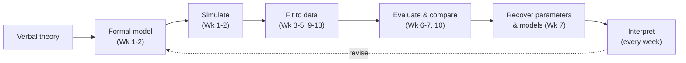
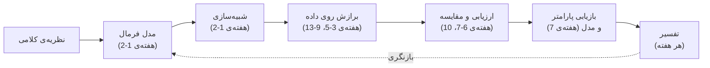

# Week 1: What Is a Cognitive Model? · هفته‌ی 1: مدل شناختی چیست؟

> **Chapter 1: Fundamentals of cognitive modeling** · Lecture 1 h · Lab 2 h
> **This week's running model:** a simple random walk model of two-choice decisions.

<div dir="rtl">

> **فصل 1: مبانی مدل‌سازی شناختی** · درس 1 ساعت · lab 2 ساعت
> **مدل اصلی این هفته:** یک مدل ساده‌ی random walk (گام تصادفی) برای تصمیم‌های دوگزینه‌ای.

</div>

---

## Key terms · واژه‌های کلیدی

Important terms of this lesson, with their Persian equivalents (repeated even if they appeared in earlier weeks).

<div dir="rtl">

واژه‌های مهم این درس با معادل فارسی‌شان (حتی اگر در درس‌های قبل آمده باشند).

</div>

| English | فارسی | توضیح کوتاه |
|---|---|---|
| cognitive model | مدل شناختی | توصیف دقیق و ریاضی یا محاسباتی از یک فرایند ذهنی |
| random walk | گام تصادفی | جمع شدن گام‌به‌گام شواهد تا رسیدن به یک مرز |
| verbal theory | نظریه‌ی کلامی | نظریه‌ای که فقط با کلمات بیان شده و پیش‌بینی دقیق نمی‌دهد |
| Marr's levels | سطوح تحلیل Marr | سطح محاسباتی، الگوریتمی و پیاده‌سازی |
| parameter | پارامتر | کمیت قابل تنظیم مدل که بین افراد یا شرایط فرق می‌کند |
| noise | نویز | تغییرات تصادفی در شواهد یا در داده |
| simulation | شبیه‌سازی | تولید داده‌ی مصنوعی با اجرای مدل |
| drift rate | نرخ رانش | سرعت میانگین جمع شدن شواهد؛ نشانه‌ی کیفیت شواهد |
| boundary separation | فاصله‌ی مرزها | مقدار شواهد لازم برای پاسخ؛ نشانه‌ی احتیاط |
| evidence | شواهد | اطلاعاتی که برای تصمیم جمع می‌شود |
| accuracy | دقت | نسبت پاسخ‌های درست |
| response time (RT) | زمان واکنش | فاصله‌ی ارائه‌ی محرک تا پاسخ |
| formal model / formalize | مدل فرمال / فرمال کردن | نوشتن نظریه به شکل معادله یا الگوریتم |
| fit / fitting | برازش | تنظیم پارامترها تا مدل با داده جور شود |
| forward / inverse problem | مسئله‌ی مستقیم / معکوس | شبیه‌سازی (پارامتر ← داده) در برابر برآورد (داده ← پارامتر) |
| non-decision time | زمان غیرتصمیمی | زمان دیدن محرک و اجرای حرکت پاسخ |
| speed–accuracy trade-off | بده‌بستان سرعت و دقت | سریع‌تر پاسخ دادن به قیمت خطای بیشتر |
| trial | کوشش (trial) | یک بار انجام تکلیف توسط شرکت‌کننده |
| probabilistic programming | برنامه‌نویسی احتمالاتی | تعریف مدل با کد و نمونه‌گیری خودکار (PyMC) |
| temperature | دما (temperature) | پارامتر نویز در انتخاب token؛ β = 1/T |
| random seed | seed تصادفی | عدد شروع مولد اعداد تصادفی برای تکرارپذیری |
| quantile | چندک (quantile) | مقداری که درصد مشخصی از داده زیر آن است |
| large language model (LLM) | مدل بزرگ زبانی | شبکه‌ی عصبی‌ای که کلمه‌ی بعدی متن را پیش‌بینی می‌کند |
| token | token (واحد متن) | کلمه یا بخشی از کلمه که مدل زبانی پیش‌بینی می‌کند |

---

## Learning outcomes · اهداف یادگیری

By the end of this week, students will be able to:

<div dir="rtl">

در پایان این هفته، دانشجویان می‌توانند:

</div>

1. **Define** a cognitive model and **distinguish** it from a verbal theory and from a purely statistical model of the data.
2. **Classify** models by purpose (descriptive, process, normative) and by family (symbolic, connectionist, stochastic/dynamical, Bayesian), and **place** them on Marr's three levels.
3. **Explain** how free parameters, a deterministic core and a noise model together turn a model into a *data-generating* machine.
4. **Implement** and **simulate** a random walk decision model in Python, and **verify** the simulation against analytic predictions.
5. **Interpret** how changes in the model's parameters (drift, boundary) map onto psychological constructs (evidence quality, caution).

<div dir="rtl">

1. مدل شناختی را **تعریف کنند** و آن را از یک نظریه‌ی کلامی و از یک مدل صرفاً آماری داده‌ها **متمایز کنند**.
2. مدل‌ها را بر اساس هدف (توصیفی، فرایندی، هنجاری) و خانواده (نمادین، پیوندگرا یا connectionist، تصادفی/پویا، بیزی) **دسته‌بندی کنند** و جایشان را در سه سطح Marr **مشخص کنند**.
3. **توضیح دهند** که چطور پارامترهای آزاد، یک هسته‌ی قطعی و یک مدل نویز (noise model) با هم یک مدل را به یک ماشین *تولید داده* تبدیل می‌کنند.
4. یک مدل تصمیم‌گیری random walk را در Python **پیاده‌سازی** و **شبیه‌سازی کنند** و شبیه‌سازی را با پیش‌بینی‌های تحلیلی **بررسی کنند**.
5. **تفسیر کنند** که تغییر پارامترهای مدل (drift، مرز) با کدام سازه‌های روان‌شناختی (کیفیت شواهد، احتیاط) متناظر است.

</div>

---

## Motivation & big picture · مقدمه

Consider a familiar verbal theory of simple decisions:

<div dir="rtl">

یک نظریه‌ی کلامی آشنا درباره‌ی تصمیم‌های ساده را در نظر بگیرید:

</div>

> *"When people decide, they gather evidence until they have enough, then they respond."*

<div dir="rtl">

> *«آدم‌ها وقتی تصمیم می‌گیرند، آن‌قدر شواهد جمع می‌کنند تا کافی شود و بعد پاسخ می‌دهند.»*

</div>

It sounds complete, but try to get a prediction out of it:

<div dir="rtl">

کامل به نظر می‌رسد، ولی سعی کنید از آن یک پیش‌بینی بیرون بکشید:

</div>

- If we tell participants to *be accurate* rather than *be fast*, how much slower should they get? Twice as slow? 50 ms slower?
- Are **errors** faster or slower than correct responses, or equally fast?
- Should the response time (RT) distribution be symmetric or skewed?
- If a stimulus becomes harder to see, should RTs change in the same way as under an accuracy instruction?

<div dir="rtl">

- اگر به شرکت‌کننده‌ها بگوییم *دقیق باشید* به‌جای *سریع باشید*، چقدر کندتر می‌شوند؟ دو برابر؟ 50 میلی‌ثانیه؟
- آیا **خطاها** سریع‌تر از پاسخ‌های درست‌اند، کندتر، یا همان‌قدر؟
- توزیع زمان واکنش (RT) باید متقارن باشد یا چوله (skewed)؟
- اگر دیدن محرک سخت‌تر شود، آیا زمان واکنش همان‌طور تغییر می‌کند که با دستور «دقیق باشید»؟

</div>

The verbal theory **cannot answer any of these**. Each answer depends on decisions the theory never made: What counts as "evidence"? Does it arrive continuously or in chunks? What does "enough" mean? Is the threshold the same for both responses?

<div dir="rtl">

این نظریه‌ی کلامی **به هیچ‌کدام از این سؤال‌ها نمی‌تواند جواب دهد**. هر جواب به تصمیم‌هایی بستگی دارد که نظریه هرگز نگرفته است: «شواهد» یعنی چه؟ پیوسته می‌رسد یا تکه‌تکه؟ «کافی» یعنی چقدر؟ آستانه برای هر دو پاسخ یکی است؟

</div>

As soon as we write the theory down as a model, for example a **random walk** that steps up or down until it reaches a boundary, every one of those questions gets a definite answer. Some answers will turn out to be *wrong*, and that is useful: a model that can be wrong is a model we can learn from. This is the central message of the course:

<div dir="rtl">

به‌محض اینکه نظریه را به شکل یک مدل بنویسیم، مثلاً یک **random walk** که گام‌به‌گام بالا یا پایین می‌رود تا به یک مرز برسد، هر کدام از این سؤال‌ها جواب مشخصی پیدا می‌کند. بعضی از این جواب‌ها *غلط* از آب درمی‌آیند، و این خوب است: مدلی که می‌تواند غلط باشد، مدلی است که می‌شود از آن یاد گرفت. این پیام اصلی این درس است:

</div>

> Formal models force us to make our assumptions explicit, produce precise predictions, and turn "Is this theory right?" into "How well, and why, does this model account for the data?"

<div dir="rtl">

> مدل‌های فرمال (formal) ما را مجبور می‌کنند فرض‌هایمان را صریح کنیم، پیش‌بینی‌های دقیق می‌دهند، و سؤال «آیا این نظریه درست است؟» را به سؤال «این مدل داده‌ها را چقدر خوب، و چرا، توضیح می‌دهد؟» تبدیل می‌کنند.

</div>

#### Where is this used? · این موضوع کجا به کار می‌رود؟

Models like the random walk of this week are not only classroom examples. They are used every day in research and practice:

- **Clinical psychology and psychiatry.** Patients with depression, ADHD or anxiety are often "slower" in simple tasks. Decision models show *why*: lower evidence quality, more caution, or slower motor responses. These three explanations call for different interventions.
- **Ageing research.** Older adults respond more slowly. Fitting decision models showed that much of this slowing comes from more caution and slower motor execution, not from worse information processing.
- **Neuroscience.** Neurons in some brain areas increase their firing rate until a threshold before a decision, much like a random walk reaching a boundary. Model parameters are used to link behavior and brain activity.
- **Applied settings.** Eyewitness decisions, medical image reading and quality control all involve deciding under noisy evidence. The same model separates "how good is the evidence" from "how careful is the decision maker".
- **Artificial intelligence.** Ideas from cognitive models (evidence accumulation, learning from errors, probabilistic inference) are used in AI systems, and AI models are now tested with the methods of this course (see the AI & LLMs section).

<div dir="rtl">

مدل‌هایی مثل random walk این هفته فقط مثال کلاسی نیستند. هر روز در پژوهش و کار عملی از آن‌ها استفاده می‌شود:

- **روان‌شناسی بالینی و روان‌پزشکی.** بیماران افسرده، مبتلا به ADHD یا اضطراب اغلب در تکلیف‌های ساده «کندتر» هستند. مدل‌های تصمیم نشان می‌دهند *چرا*: کیفیت پایین‌تر شواهد، احتیاط بیشتر، یا پاسخ حرکتی کندتر. این سه توضیح به مداخله‌های متفاوتی نیاز دارند.
- **پژوهش درباره‌ی سالمندی.** افراد مسن‌تر کندتر پاسخ می‌دهند. برازش مدل‌های تصمیم نشان داده که بخش زیادی از این کندی از احتیاط بیشتر و کندی حرکت می‌آید، نه از ضعف در پردازش اطلاعات.
- **علوم اعصاب.** نرخ شلیک نورون‌های بعضی نواحی مغز پیش از تصمیم کم‌کم بالا می‌رود تا به یک آستانه برسد؛ خیلی شبیه random walk که به مرز می‌رسد. از پارامترهای مدل برای وصل کردن رفتار و فعالیت مغز استفاده می‌شود.
- **کاربردهای عملی.** تصمیم شاهد عینی، خواندن تصویر پزشکی و کنترل کیفیت، همه تصمیم‌گیری با شواهد پرنویز هستند. همین مدل «شواهد چقدر خوب است» را از «تصمیم‌گیرنده چقدر محتاط است» جدا می‌کند.
- **هوش مصنوعی.** ایده‌های مدل‌های شناختی (جمع شدن شواهد، یادگیری از خطا، استنباط احتمالاتی) در سیستم‌های هوش مصنوعی به کار رفته‌اند، و امروز مدل‌های هوش مصنوعی هم با روش‌های همین درس آزموده می‌شوند (بخش هوش مصنوعی و LLMها را ببینید).

</div>

---

## Lecture notes · جزوه‌ی درس

#### In plain words · به زبان ساده

A *theory* says something in words ("people collect evidence until they have enough"). A *model* says the same thing so precisely that a computer can run it. Once it can run, the model makes exact predictions: how often people will be correct, how long they will take, and how both change when we change the task. This week's model is the simplest possible decision model. Imagine a token on a number line. Each moment it moves one step up (a bit of evidence for the correct answer) or one step down (a bit of evidence for the wrong answer). When it reaches the top line, the person answers correctly; when it reaches the bottom line, they make an error. Only three numbers control everything: how strongly the steps lean upward (**drift**, the quality of the evidence), how far apart the two lines are (**boundary separation**, how careful the person is), and where the token starts (**starting point**, bias). By running this little machine many times we can see a speed–accuracy trade-off appear by itself, without programming it in.

<div dir="rtl">

*نظریه* یک حرف را با کلمات می‌زند («آدم‌ها شواهد جمع می‌کنند تا به اندازه‌ی کافی برسد»). *مدل* همان حرف را آن‌قدر دقیق می‌زند که کامپیوتر بتواند اجرایش کند. وقتی مدل اجرا شود، پیش‌بینی دقیق می‌دهد: آدم‌ها چند درصد مواقع درست جواب می‌دهند، چقدر طول می‌کشد، و این دو با تغییر تکلیف چطور عوض می‌شوند. مدل این هفته ساده‌ترین مدل تصمیم ممکن است. یک مهره روی یک خط عددی را تصور کنید. در هر لحظه یک قدم بالا می‌رود (کمی شاهد به نفع جواب درست) یا یک قدم پایین (کمی شاهد به نفع جواب غلط). وقتی به خط بالا برسد، فرد درست جواب می‌دهد؛ وقتی به خط پایین برسد، خطا می‌کند. فقط سه عدد همه‌چیز را کنترل می‌کنند: قدم‌ها چقدر به سمت بالا تمایل دارند (**drift**، کیفیت شواهد)، دو خط چقدر از هم فاصله دارند (**فاصله‌ی مرزها**، میزان احتیاط فرد)، و مهره از کجا شروع می‌کند (**نقطه‌ی شروع**، سوگیری). با چند بار اجرای این ماشین کوچک می‌بینیم که بده‌بستان سرعت و دقت خودبه‌خود ظاهر می‌شود، بدون اینکه آن را در مدل گذاشته باشیم.

</div>

#### Psychology words in plain language · واژه‌های روان‌شناسی به زبان ساده

- **Participant (subject):** a person who takes part in an experiment.
- **Stimulus (plural stimuli):** whatever is shown or played to the participant, e.g. a picture, a word or a tone.
- **Task:** what the participant must do, e.g. "press left if the dots move left, right if they move right". A **two-choice task** has exactly two possible responses.
- **Trial:** one repetition of the task: one stimulus, one response. An experiment usually has hundreds of trials per participant.
- **Response time (RT, reaction time):** the time from stimulus onset to the key press, usually in milliseconds (ms).
- **Accuracy:** the proportion of correct responses.
- **Condition / manipulation:** a change the experimenter makes on purpose (e.g. "be fast!" vs. "be accurate!" instructions, or easy vs. hard stimuli), to see how behavior changes.
- **Construct:** a psychological quantity we cannot observe directly, e.g. *caution*, *attention* or *memory strength*. A good model parameter *measures* a construct.
- **Behavioral data:** what we can record: choices and RTs (not brain signals).

<div dir="rtl">

- **شرکت‌کننده (participant یا subject):** کسی که در آزمایش شرکت می‌کند.
- **محرک (stimulus، جمع stimuli):** هر چیزی که به شرکت‌کننده نشان داده یا پخش می‌شود؛ مثلاً یک تصویر، یک کلمه یا یک صدا.
- **تکلیف (task):** کاری که شرکت‌کننده باید انجام دهد؛ مثلاً «اگر نقطه‌ها به چپ می‌روند کلید چپ و اگر به راست می‌روند کلید راست را بزن». **تکلیف دوگزینه‌ای** دقیقاً دو پاسخ ممکن دارد.
- **trial (کوشش):** یک بار انجام تکلیف: یک محرک، یک پاسخ. هر آزمایش معمولاً برای هر شرکت‌کننده صدها trial دارد.
- **زمان واکنش (RT):** فاصله‌ی زمانی از ظاهر شدن محرک تا زدن کلید، معمولاً بر حسب میلی‌ثانیه (ms).
- **دقت (accuracy):** نسبت پاسخ‌های درست.
- **شرط یا دست‌کاری (condition / manipulation):** تغییری که آزمایشگر عمداً ایجاد می‌کند (مثلاً دستورالعمل «سریع باش!» در برابر «دقیق باش!»، یا محرک آسان در برابر سخت) تا ببیند رفتار چطور تغییر می‌کند.
- **سازه (construct):** یک کمیت روان‌شناختی که مستقیم دیده نمی‌شود؛ مثلاً *احتیاط*، *توجه* یا *قدرت حافظه*. یک پارامتر خوب مدل، یک سازه را *اندازه می‌گیرد*.
- **داده‌ی رفتاری:** چیزی که می‌توانیم ثبت کنیم: انتخاب‌ها و زمان‌های واکنش (نه سیگنال‌های مغزی).

</div>

**Suggested timing (60 min):** motivation 10 · what and why 10 · kinds of models + Marr 15 · models as data-generating machines + pipeline 10 · first model (random walk) 12 · notation and course logistics 3.

<div dir="rtl">

**زمان‌بندی پیشنهادی (60 دقیقه):** انگیزه 10 · چیستی و چرایی 10 · انواع مدل + Marr 15 · مدل به‌عنوان ماشین تولید داده + مسیر مدل‌سازی 10 · اولین مدل (random walk) 12 · نمادگذاری و نکات اجرایی درس 3.

</div>

### 1. What is a cognitive model? · 1. مدل شناختی چیست؟

A **cognitive model** is an explicit, usually mathematical or computational, description of the processes or representations that are assumed to produce behavior. It has three ingredients:

<div dir="rtl">

**مدل شناختی** توصیفی صریح، معمولاً ریاضی یا محاسباتی، از فرایندها یا بازنمایی‌هایی است که فرض می‌کنیم رفتار را تولید می‌کنند. سه جزء دارد:

</div>

| Ingredient | Question it answers | Random walk example |
|---|---|---|
| **Assumptions / structure** | What mechanism do we posit? | Evidence accumulates in discrete steps between two boundaries |
| **Parameters** | Which quantities are free to vary across people or conditions? | Drift $v$, boundary separation $a$, start point $z$ |
| **Mapping to data** | How does the mechanism produce observable responses? | The boundary reached gives the choice; the number of steps gives the RT |

<div dir="rtl">

| جزء | به چه سؤالی جواب می‌دهد | مثال در random walk |
|---|---|---|
| **فرض‌ها / ساختار** | چه سازوکاری را فرض می‌کنیم؟ | شواهد در گام‌های گسسته بین دو مرز انباشته می‌شود |
| **پارامترها** | کدام کمیت‌ها می‌توانند بین افراد یا شرایط تغییر کنند؟ | drift $v$، فاصله‌ی مرزها $a$، نقطه‌ی شروع $z$ |
| **نگاشت به داده** | سازوکار چگونه پاسخ‌های قابل مشاهده تولید می‌کند؟ | مرزی که به آن می‌رسیم انتخاب را تعیین می‌کند؛ تعداد گام‌ها زمان واکنش را |

</div>

Three related terms are easy to mix up:

<div dir="rtl">

سه اصطلاح مرتبط که به‌راحتی با هم قاطی می‌شوند:

</div>

- A **theory** is a set of verbal (often informal) claims about the mind.
- A **model** is one particular formal instantiation of a theory. One theory can be formalized in many different ways.
- A **statistical model** (a t-test, a regression) is also a model, but of the *data*. Its parameters (means, slopes) usually describe the data rather than a cognitive process. In a cognitive model the parameters are meant to **measure latent psychological quantities**, such as memory decay, caution or attention.

<div dir="rtl">

- **نظریه** مجموعه‌ای از ادعاهای کلامی (اغلب غیررسمی) درباره‌ی ذهن است.
- **مدل** یک نمونه‌ی فرمال مشخص از یک نظریه است. یک نظریه را می‌شود به شکل‌های مختلفی فرمال کرد.
- **مدل آماری** (مثل t-test یا رگرسیون) هم مدل است، ولی مدلِ *داده‌ها*. پارامترهایش (میانگین‌ها، شیب‌ها) معمولاً داده‌ها را توصیف می‌کنند، نه یک فرایند شناختی را. در مدل شناختی، پارامترها قرار است **کمیت‌های روان‌شناختی پنهان را اندازه بگیرند**، مثل زوال حافظه، احتیاط یا توجه.

</div>

George Box's often-quoted remark that "all models are wrong, but some are useful" sums up the attitude of this course. We never ask whether a model is *true*. We ask whether it is *useful*: does it capture the important regularities, generalize to new data, and have interpretable parameters?

<div dir="rtl">

جمله‌ی معروف George Box که «همه‌ی مدل‌ها غلط‌اند، ولی بعضی‌شان مفیدند» نگرش این درس را خلاصه می‌کند. ما هیچ‌وقت نمی‌پرسیم یک مدل *درست* است یا نه. می‌پرسیم *مفید* است یا نه: آیا الگوهای مهم را نشان می‌دهد، به داده‌ی جدید تعمیم پیدا می‌کند، و پارامترهای قابل تفسیر دارد؟

</div>

### 2. Why bother with formal models? · 2. چرا اصلاً مدل فرمال بسازیم؟

1. **Precision.** Writing the model down exposes hidden assumptions (as in the motivation example).
2. **Quantitative predictions.** Models predict *how much*, not just *whether*.
3. **Deriving surprising consequences.** Our intuitions about complex systems are poor. For example, averaging individual exponential learning curves produces a curve that looks like a *power* law (Week 5).
4. **Measurement.** Fitted parameters are measurements of latent constructs. $d'$ in signal detection theory (Week 2) measures sensitivity separately from response bias, which raw accuracy cannot do.
5. **Comparing theories.** Two verbal theories that "both explain the data" can be pitted against each other once they are formalized (Weeks 6–7, 10).
6. **Bridge to AI.** The same formalisms (probabilistic models, learning rules, neural networks) are used to build artificial agents (Week 15).

<div dir="rtl">

1. **دقت.** نوشتن مدل فرض‌های پنهان را آشکار می‌کند (مثل مثال بخش انگیزه).
2. **پیش‌بینی کمّی.** مدل‌ها می‌گویند *چقدر*، نه فقط *آیا*.
3. **کشف پیامدهای غیرمنتظره.** شهود ما درباره‌ی سیستم‌های پیچیده ضعیف است. مثلاً میانگین‌گیری از منحنی‌های یادگیری نمایی افراد، منحنی‌ای می‌سازد که شبیه قانون *توانی* است (هفته‌ی 5).
4. **اندازه‌گیری.** پارامترهای برازش‌شده اندازه‌گیری سازه‌های پنهان‌اند. $d'$ در نظریه‌ی تشخیص علامت (هفته‌ی 2) حساسیت را جدا از سوگیری پاسخ اندازه می‌گیرد؛ کاری که درصد پاسخ درست به‌تنهایی نمی‌تواند بکند.
5. **مقایسه‌ی نظریه‌ها.** دو نظریه‌ی کلامی که «هر دو داده‌ها را توضیح می‌دهند» بعد از فرمال شدن قابل رقابت با هم‌اند (هفته‌های 6–7 و 10).
6. **پلی به هوش مصنوعی.** همین صورت‌بندی‌ها (مدل‌های احتمالاتی، قواعد یادگیری، شبکه‌های عصبی) برای ساختن عامل‌های مصنوعی هم به کار می‌روند (هفته‌ی 15).

</div>

### 3. Kinds of cognitive models · 3. انواع مدل‌های شناختی

**By purpose:**

<div dir="rtl">

**بر اساس هدف:**

</div>

| Type | Question | Example | Course weeks |
|---|---|---|---|
| **Descriptive** | *What* is the shape of the data? | Power law of practice; exponential forgetting curve | 2–7 |
| **Process (mechanistic)** | *How* does the mind produce the behavior? | Random walk / drift-diffusion; exemplar model (GCM) | 1, 14 |
| **Normative (rational)** | What *should* an ideal agent do? | Bayesian ideal observer for cue combination | 15 |

<div dir="rtl">

| نوع | سؤال | مثال | هفته‌ها |
|---|---|---|---|
| **توصیفی (descriptive)** | شکل داده‌ها *چیست*؟ | قانون توانی تمرین؛ منحنی فراموشی نمایی | 2–7 |
| **فرایندی (process / mechanistic)** | ذهن *چگونه* رفتار را تولید می‌کند؟ | random walk / drift-diffusion؛ مدل exemplar (GCM) | 1، 14 |
| **هنجاری (normative / rational)** | یک عامل ایده‌آل *باید* چه کند؟ | مشاهده‌گر ایده‌آل بیزی برای ترکیب سرنخ‌ها | 15 |

</div>

The boundaries are fuzzy: an SDT model is partly descriptive and partly a process model.

<div dir="rtl">

مرزها مبهم‌اند: مدل SDT تا حدی توصیفی و تا حدی فرایندی است.

</div>

**By family:**

<div dir="rtl">

**بر اساس خانواده:**

</div>

| Family | Core idea | Example |
|---|---|---|
| Symbolic / rule-based | Cognition as manipulation of symbols and production rules | ACT-R production systems |
| Connectionist | Distributed representations, learning by weight change | Delta-rule networks, deep networks |
| Stochastic / dynamical | Noisy processes unfolding in time | Random walk, drift-diffusion, Rescorla–Wagner |
| Bayesian (probabilistic) | Cognition as probabilistic inference | Bayesian observer models |

<div dir="rtl">

| خانواده | ایده‌ی اصلی | مثال |
|---|---|---|
| نمادین / مبتنی بر قاعده | شناخت به‌عنوان دست‌کاری نمادها و قواعد تولید (production rules) | سیستم‌های تولید ACT-R |
| پیوندگرا (connectionist) | بازنمایی‌های توزیع‌شده، یادگیری با تغییر وزن‌ها | شبکه‌های قاعده‌ی دلتا، شبکه‌های عمیق |
| تصادفی / پویا (stochastic / dynamical) | فرایندهای پرنویز که در زمان پیش می‌روند | random walk، drift-diffusion، Rescorla–Wagner |
| بیزی (احتمالاتی) | شناخت به‌عنوان استنباط احتمالاتی | مدل‌های مشاهده‌گر بیزی |

</div>

> **Watch out:** "Bayesian modeling" in this course means two different things. (a) **Bayesian models of cognition** claim that the *mind* does Bayesian inference (Week 15). (b) **Bayesian data analysis** is how *we, the scientists,* estimate the parameters of any model, Bayesian or not (Weeks 9–13). Weeks 9–13 are mostly about (b).

<div dir="rtl">

> **مراقب باشید:** «مدل‌سازی بیزی» در این درس دو معنای متفاوت دارد. (الف) **مدل‌های بیزی شناخت** ادعا می‌کنند که *ذهن* استنباط بیزی انجام می‌دهد (هفته‌ی 15). (ب) **تحلیل داده‌ی بیزی** روشی است که *ما پژوهشگران* با آن پارامترهای هر مدلی را، بیزی یا غیربیزی، برآورد می‌کنیم (هفته‌های 9–13). هفته‌های 9–13 بیشتر درباره‌ی (ب) هستند.

</div>

### 4. Marr's three levels of analysis · 4. سه سطح تحلیل Marr

David Marr proposed analyzing an information-processing system at three complementary levels:

<div dir="rtl">

David Marr پیشنهاد کرد که یک سیستم پردازش اطلاعات را در سه سطح مکمل تحلیل کنیم:

</div>

| Level | Question | Decision example |
|---|---|---|
| **Computational** | What problem is being solved, and why? | Choose the correct alternative while balancing speed and accuracy |
| **Algorithmic / representational** | What representations and procedures solve it? | Accumulate noisy evidence until a boundary is reached |
| **Implementational** | How is it realized physically? | Firing rates of neurons ramping up to a threshold |

<div dir="rtl">

| سطح | سؤال | مثال تصمیم‌گیری |
|---|---|---|
| **محاسباتی (computational)** | چه مسئله‌ای حل می‌شود و چرا؟ | انتخاب گزینه‌ی درست با برقراری تعادل بین سرعت و دقت |
| **الگوریتمی / بازنمایی (algorithmic)** | چه بازنمایی‌ها و رویه‌هایی آن را حل می‌کنند؟ | انباشت شواهد پرنویز تا رسیدن به یک مرز |
| **پیاده‌سازی (implementational)** | به‌طور فیزیکی چگونه محقق می‌شود؟ | نرخ شلیک نورون‌ها که تا یک آستانه بالا می‌رود |

</div>

Normative models usually live at the computational level, process models at the algorithmic level, and computational neuroscience models at the implementational level. Most models in this course are **algorithmic-level** models.

<div dir="rtl">

مدل‌های هنجاری معمولاً در سطح محاسباتی‌اند، مدل‌های فرایندی در سطح الگوریتمی، و مدل‌های علوم اعصاب محاسباتی در سطح پیاده‌سازی. بیشتر مدل‌های این درس **در سطح الگوریتمی** هستند.

</div>

### 5. A model is a data-generating machine · 5. مدل یک ماشین تولید داده است

The single most important idea for the rest of the course: **a model specifies a probability distribution over possible data.**

<div dir="rtl">

مهم‌ترین ایده برای ادامه‌ی درس: **مدل یک توزیع احتمال روی داده‌های ممکن تعریف می‌کند.**

</div>

$$
\mathbf{y} \sim p(\mathbf{y} \mid \boldsymbol{\theta}, \mathcal{M})
$$

Read this as: "under model $\mathcal{M}$ with parameters $\boldsymbol{\theta}$, the data $\mathbf{y}$ are generated from the distribution $p$." Many models split this into a deterministic core plus noise, for example $y_i = f(x_i; \boldsymbol{\theta}) + \varepsilon_i$ (Week 2). Others, like the random walk, are stochastic all the way through.

<div dir="rtl">

این را این‌طور بخوانید: «تحت مدل $\mathcal{M}$ با پارامترهای $\boldsymbol{\theta}$، داده‌ی $\mathbf{y}$ از توزیع $p$ تولید می‌شود.» بسیاری از مدل‌ها این را به یک هسته‌ی قطعی به‌علاوه‌ی نویز تقسیم می‌کنند، مثلاً $y_i = f(x_i; \boldsymbol{\theta}) + \varepsilon_i$ (هفته‌ی 2). بعضی دیگر، مثل random walk، از اول تا آخر تصادفی‌اند.

</div>

This gives two directions of reasoning:

<div dir="rtl">

این دو جهت استدلال به ما می‌دهد:

</div>

| Direction | Given | Find | Name | Course weeks |
|---|---|---|---|---|
| **Forward** | $\boldsymbol\theta$ | Possible data $\mathbf{y}$ | Simulation / prediction | 1–2 |
| **Inverse** | Observed $\mathbf{y}$ | Plausible $\boldsymbol\theta$ | Parameter estimation / fitting | 3–5, 9–13 |

<div dir="rtl">

| جهت | داده‌شده | خواسته‌شده | نام | هفته‌ها |
|---|---|---|---|---|
| **مستقیم (forward)** | $\boldsymbol\theta$ | داده‌های ممکن $\mathbf{y}$ | شبیه‌سازی / پیش‌بینی | 1–2 |
| **معکوس (inverse)** | $\mathbf{y}$ مشاهده‌شده | $\boldsymbol\theta$ محتمل | برآورد پارامتر / برازش | 3–5، 9–13 |

</div>

The inverse problem is harder. It is what we mean by "fitting a model to data". Because a model can always be run forwards, we can also test our fitting methods: simulate data from **known** parameters $\boldsymbol\theta^\ast$, fit, and check whether we get $\boldsymbol\theta^\ast$ back (*parameter recovery*, Week 7).

<div dir="rtl">

مسئله‌ی معکوس سخت‌تر است و همان چیزی است که منظورمان از «برازش مدل روی داده» است. چون همیشه می‌توان مدل را در جهت مستقیم اجرا کرد، می‌توانیم روش‌های برازشمان را هم آزمون کنیم: از پارامترهای **معلوم** $\boldsymbol\theta^\ast$ داده شبیه‌سازی کنیم، برازش کنیم، و ببینیم آیا $\boldsymbol\theta^\ast$ را پس می‌گیریم (*بازیابی پارامتر* یا parameter recovery، هفته‌ی 7).

</div>

#### Reading the math · خواندن ریاضی

$\mathbf{y} \sim p(\mathbf{y} \mid \boldsymbol{\theta}, \mathcal{M})$ is read: "the data $\mathbf{y}$ are drawn from the probability distribution $p$, given the parameter values $\boldsymbol\theta$ and the model $\mathcal{M}$."

- $\mathbf{y}$ (bold) is a *list* of observations, e.g. the 200 responses of one participant.
- The symbol $\sim$ means "is randomly generated from". It reminds us that the same model with the same parameters gives *different* data each time, just as a person does not respond identically on every trial.
- The vertical bar $\mid$ means "given" or "assuming". Everything to the right of it is fixed: the model's equations ($\mathcal{M}$) and the numbers we plug into them ($\boldsymbol\theta$).
- $\boldsymbol\theta$ (theta, bold) collects all parameters, e.g. $\boldsymbol\theta = (v, a, z)$ for the random walk.

**Example.** For a coin with $P(\text{heads}) = 0.6$, the model is "each flip is heads with probability $\theta$", $\boldsymbol\theta = 0.6$, and $\mathbf{y}$ could be (H, T, H, H, T). Run it again and you get another sequence. *Forward* direction: choose $\theta$, simulate $\mathbf{y}$. *Inverse* direction (fitting, Weeks 3–5): see $\mathbf{y}$, find a good $\theta$.

<div dir="rtl">

$\mathbf{y} \sim p(\mathbf{y} \mid \boldsymbol{\theta}, \mathcal{M})$ این‌طور خوانده می‌شود: «داده‌ی $\mathbf{y}$ از توزیع احتمال $p$ تولید می‌شود، به شرط مقادیر پارامتر $\boldsymbol\theta$ و مدل $\mathcal{M}$.»

- $\mathbf{y}$ (پررنگ) یک *فهرست* از مشاهده‌هاست؛ مثلاً 200 پاسخ یک شرکت‌کننده.
- علامت $\sim$ یعنی «به‌طور تصادفی تولید می‌شود از». یادآوری می‌کند که یک مدل با پارامترهای ثابت هر بار داده‌ی *متفاوتی* می‌دهد، همان‌طور که یک آدم هم در هر trial دقیقاً یکسان پاسخ نمی‌دهد.
- خط عمودی $\mid$ یعنی «به شرطِ» یا «با فرضِ». هر چیزی سمت راستش ثابت است: معادله‌های مدل ($\mathcal{M}$) و عددهایی که در آن‌ها می‌گذاریم ($\boldsymbol\theta$).
- $\boldsymbol\theta$ (تتا، پررنگ) همه‌ی پارامترها را کنار هم می‌گذارد؛ مثلاً برای random walk داریم $\boldsymbol\theta = (v, a, z)$.

**مثال.** برای سکه‌ای با $P(\text{heads}) = 0.6$، مدل این است: «هر پرتاب با احتمال $\theta$ شیر می‌آید»، $\boldsymbol\theta = 0.6$، و $\mathbf{y}$ می‌تواند (شیر، خط، شیر، شیر، خط) باشد. دوباره اجرا کنید، دنباله‌ی دیگری می‌گیرید. جهت *مستقیم*: $\theta$ را انتخاب کن و $\mathbf{y}$ را شبیه‌سازی کن. جهت *معکوس* (برازش، هفته‌های 3 تا 5): $\mathbf{y}$ را ببین و یک $\theta$ خوب پیدا کن.

</div>

### 6. The modeling pipeline (our roadmap) · 6. مسیر مدل‌سازی (نقشه‌ی راه ما)



<div dir="rtl">



</div>

Every lab in this course runs some version of this loop. Today we focus on **formalize → simulate → interpret**, with a small preview of **fit**.

<div dir="rtl">

هر lab در این درس نسخه‌ای از این چرخه را اجرا می‌کند. امروز روی **فرمال‌سازی ← شبیه‌سازی ← تفسیر** تمرکز می‌کنیم، به‌علاوه‌ی پیش‌نمایش کوچکی از **برازش**.

</div>

### 7. Our first model: a random walk to a boundary · 7. اولین مدل ما: random walk تا رسیدن به مرز

**Verbal → formal.** Evidence is a single number $X$ that starts at $z$. At each time step it moves **up by 1** (evidence for the correct response) or **down by 1** (evidence for the error response). The walk stops when $X$ reaches the upper boundary $a$ (correct response) or the lower boundary $0$ (error).

<div dir="rtl">

**از کلامی به فرمال.** شواهد یک عدد واحد $X$ است که از $z$ شروع می‌شود. در هر گام زمانی **یک واحد بالا** می‌رود (شواهد به نفع پاسخ درست) یا **یک واحد پایین** (شواهد به نفع پاسخ غلط). وقتی $X$ به مرز بالا $a$ (پاسخ درست) یا مرز پایین $0$ (خطا) برسد، حرکت متوقف می‌شود.

</div>

$$
X_0 = z, \qquad X_{n} = X_{n-1} + \delta_n, \qquad
\delta_n =
\begin{cases}
+1 & \text{with probability } \tfrac{1+v}{2}\\[2pt]
-1 & \text{with probability } \tfrac{1-v}{2}
\end{cases}
$$

- $v \in (-1, 1)$ is the **drift**, the average step $\mathbb{E}[\delta_n] = v$. It represents the **quality of evidence**: easy stimuli give a large $v$.
- $a$ is the **boundary separation**. It represents **caution**: a wider gap needs more evidence.
- $z$ is the **start point** ($0 < z < a$). With $z = a/2$ the decision maker is unbiased.
- The number of steps until absorption, $T$, maps onto RT through
$$
\mathrm{RT} = t_0 + T\,\Delta t,
$$
where $t_0$ is **non-decision time** (encoding plus motor execution) and $\Delta t$ is the duration of one step.

<div dir="rtl">

- $v \in (-1, 1)$ همان **drift** است، یعنی میانگین گام $\mathbb{E}[\delta_n] = v$. نماینده‌ی **کیفیت شواهد** است: محرک‌های آسان $v$ بزرگ می‌دهند.
- $a$ **فاصله‌ی مرزها** (boundary separation) است و نماینده‌ی **احتیاط**: فاصله‌ی بیشتر یعنی شواهد بیشتری لازم است.
- $z$ **نقطه‌ی شروع** است ($0 < z < a$). با $z = a/2$ تصمیم‌گیرنده بی‌سوگیری است.
- تعداد گام‌ها تا رسیدن به مرز، $T$، از این راه به زمان واکنش نگاشت می‌شود:
$$
\mathrm{RT} = t_0 + T\,\Delta t,
$$
که در آن $t_0$ **non-decision time** (non-decision time: رمزگذاری به‌علاوه‌ی اجرای حرکتی) و $\Delta t$ مدت هر گام است.

</div>

**Analytic predictions.** Let $r = \frac{1-v}{1+v}$. For $v \neq 0$, the probability of a correct response and the mean number of steps are:

<div dir="rtl">

**پیش‌بینی‌های تحلیلی.** فرض کنید $r = \frac{1-v}{1+v}$. برای $v \neq 0$، احتمال پاسخ درست و میانگین تعداد گام‌ها برابرند با:

</div>

$$
P_c = \frac{1 - r^{z}}{1 - r^{a}}, \qquad
\mathbb{E}[T] = \frac{a\,P_c - z}{v}.
$$

These two equations already settle the questions from the motivation:

<div dir="rtl">

همین دو معادله سؤال‌های بخش انگیزه را حل می‌کنند:

</div>

- Increasing $a$ raises $P_c$ **and** $\mathbb{E}[T]$: a **speed–accuracy trade-off**.
- Increasing $v$ raises $P_c$ but **lowers** $\mathbb{E}[T]$: easier stimuli are both faster and more accurate.

<div dir="rtl">

- افزایش $a$ هم $P_c$ **و هم** $\mathbb{E}[T]$ را بالا می‌برد: یک **trade-off سرعت–دقت** (speed–accuracy trade-off).
- افزایش $v$ احتمال $P_c$ را بالا می‌برد ولی $\mathbb{E}[T]$ را **پایین** می‌آورد: محرک‌های آسان‌تر هم سریع‌ترند و هم دقیق‌تر.

</div>

So the two manipulations leave different signatures in the data. That is what lets us *measure* caution and evidence quality separately.

<div dir="rtl">

پس این دو دست‌کاری ردپای متفاوتی در داده‌ها می‌گذارند. همین است که به ما اجازه می‌دهد احتیاط و کیفیت شواهد را جداگانه *اندازه بگیریم*.

</div>

> **Advanced: where the formulas come from.**
> $P_c$ is the classic *gambler's ruin* result. Let $h(x)$ be the probability of hitting $a$ before $0$ when starting from $x$. Conditioning on the first step gives $h(x) = \tfrac{1+v}{2}h(x+1) + \tfrac{1-v}{2}h(x-1)$ with $h(0)=0$ and $h(a)=1$. Solving this difference equation gives $h(x) = (1-r^x)/(1-r^a)$.
> For $\mathbb{E}[T]$, use *Wald's identity*: the final position satisfies $\mathbb{E}[X_T] = z + v\,\mathbb{E}[T]$. Since $X_T = a$ with probability $P_c$ and $X_T = 0$ otherwise, $\mathbb{E}[X_T] = aP_c$, and rearranging gives $\mathbb{E}[T] = (aP_c - z)/v$.
> As the step size and $\Delta t$ shrink together, the random walk becomes the **drift-diffusion model** (Week 14).

<div dir="rtl">

> **پیشرفته: فرمول‌ها از کجا می‌آیند.**
> $P_c$ همان نتیجه‌ی کلاسیک *ورشکستگی قمارباز* (gambler's ruin) است. فرض کنید $h(x)$ احتمال رسیدن به $a$ پیش از $0$ با شروع از $x$ باشد. شرطی کردن روی گام اول می‌دهد $h(x) = \tfrac{1+v}{2}h(x+1) + \tfrac{1-v}{2}h(x-1)$ با $h(0)=0$ و $h(a)=1$. حل این معادله‌ی تفاضلی می‌دهد $h(x) = (1-r^x)/(1-r^a)$.
> برای $\mathbb{E}[T]$ از *اتحاد Wald* استفاده کنید: موقعیت نهایی در $\mathbb{E}[X_T] = z + v\,\mathbb{E}[T]$ صدق می‌کند. چون $X_T$ با احتمال $P_c$ برابر $a$ و در غیر این صورت $0$ است، $\mathbb{E}[X_T] = aP_c$، و مرتب کردن معادله می‌دهد $\mathbb{E}[T] = (aP_c - z)/v$.
> وقتی اندازه‌ی گام و $\Delta t$ با هم کوچک شوند، random walk به **مدل drift-diffusion** (هفته‌ی 14) تبدیل می‌شود.

</div>

> **Advanced: a property that turns out to be a weakness.** With an unbiased start ($z = a/2$), the simple random walk predicts that correct and error responses have **identical RT distributions**. Empirically, errors are often *slower* than correct responses when accuracy is stressed, and sometimes *faster* under speed stress. The simple model cannot produce either pattern. Adding trial-to-trial variability in drift or start point can (lab Exercise 5). Finding where a model fails is exactly how models improve.

<div dir="rtl">

> **پیشرفته: ویژگی‌ای که نقطه‌ضعف از آب درمی‌آید.** با شروع بی‌سوگیری ($z = a/2$)، random walk ساده پیش‌بینی می‌کند که پاسخ‌های درست و غلط **توزیع زمان واکنش یکسانی** دارند. در داده‌های واقعی، وقتی بر دقت تأکید می‌شود خطاها اغلب *کندتر* از پاسخ‌های درست‌اند و گاهی تحت تأکید بر سرعت *سریع‌تر*. مدل ساده هیچ‌کدام از این الگوها را نمی‌تواند تولید کند. اضافه کردن تغییرپذیری drift یا نقطه‌ی شروع از trialی به trial دیگر می‌تواند (تمرین 5 در lab). پیدا کردن جایی که مدل شکست می‌خورد دقیقاً همان راه بهتر شدن مدل‌هاست.

</div>

#### Reading the math · خواندن ریاضی

**The update rule.** $X_n = X_{n-1} + \delta_n$ says: *the evidence now* = *the evidence one step ago* + *one new step*. The step $\delta_n$ is $+1$ or $-1$. The probability of $+1$ is $\tfrac{1+v}{2}$. With $v = 0$ this is $0.5$ (a fair coin: no information). With $v = 0.2$ it is $0.6$, so the walk drifts upward on average. The average step is $(+1)(0.6) + (-1)(0.4) = 0.2 = v$, which is why $v$ is called the drift.

**The accuracy formula.** $P_c = \dfrac{1 - r^{z}}{1 - r^{a}}$ with $r = \dfrac{1-v}{1+v}$.

- $r$ is the ratio "probability of a down step / probability of an up step". With $v = 0.2$: $r = 0.4/0.6 = 2/3$. A small $r$ means the walk almost always goes up.
- $r^{z}$ and $r^{a}$ are small numbers when $z$ and $a$ are large, so $P_c$ approaches 1. That is the math behind "more caution (larger $a$) gives higher accuracy".
- You do not need to derive the formula (see the Advanced box). It is enough to plug in numbers and check it against a simulation, as in the lab.

**The time formula.** $\mathbb{E}[T] = \dfrac{a P_c - z}{v}$. $\mathbb{E}[\cdot]$ means "average over many trials". The numerator is how far the walk travels on average (it ends at $a$ with probability $P_c$, at $0$ otherwise, and started at $z$). Dividing by the average speed $v$ gives the average number of steps, just like *time = distance / speed*.

**RT.** $\mathrm{RT} = t_0 + T\,\Delta t$: a fixed part $t_0$ (seeing the stimulus, pressing the key) plus the decision time, i.e. the number of steps times the duration of one step.

<div dir="rtl">

**قاعده‌ی به‌روزرسانی.** $X_n = X_{n-1} + \delta_n$ یعنی: *شواهد الان* = *شواهد یک قدم قبل* + *یک قدم جدید*. قدم $\delta_n$ برابر $+1$ یا $-1$ است. احتمال $+1$ برابر $\tfrac{1+v}{2}$ است. با $v = 0$ این احتمال $0.5$ است (سکه‌ی سالم: هیچ اطلاعاتی نیست). با $v = 0.2$ برابر $0.6$ است، پس مسیر به‌طور میانگین رو به بالا می‌رود. میانگین قدم برابر $(+1)(0.6) + (-1)(0.4) = 0.2 = v$ است؛ به همین دلیل به $v$ می‌گوییم drift (رانش).

**فرمول دقت.** $P_c = \dfrac{1 - r^{z}}{1 - r^{a}}$ با $r = \dfrac{1-v}{1+v}$.

- $r$ نسبت «احتمال قدم پایین / احتمال قدم بالا» است. با $v = 0.2$ داریم $r = 0.4/0.6 = 2/3$. هرچه $r$ کوچک‌تر باشد، مسیر تقریباً همیشه بالا می‌رود.
- وقتی $z$ و $a$ بزرگ باشند، $r^{z}$ و $r^{a}$ عددهای کوچکی می‌شوند و $P_c$ به 1 نزدیک می‌شود. این همان ریاضیِ پشت جمله‌ی «احتیاط بیشتر (یعنی $a$ بزرگ‌تر) دقت بیشتری می‌دهد» است.
- لازم نیست فرمول را اثبات کنید (کادر پیشرفته را ببینید). کافی است عدد بگذارید و آن را با شبیه‌سازی مقایسه کنید، همان کاری که در lab می‌کنیم.

**فرمول زمان.** $\mathbb{E}[T] = \dfrac{a P_c - z}{v}$. $\mathbb{E}[\cdot]$ یعنی «میانگین روی تعداد زیادی trial». صورت کسر مسافتی است که مسیر به‌طور میانگین طی می‌کند (با احتمال $P_c$ در $a$ و در غیر این صورت در $0$ تمام می‌شود و از $z$ شروع کرده بود). تقسیم بر سرعت میانگین $v$ تعداد میانگین قدم‌ها را می‌دهد؛ درست مثل *زمان = مسافت / سرعت*.

**زمان واکنش.** $\mathrm{RT} = t_0 + T\,\Delta t$: یک بخش ثابت $t_0$ (دیدن محرک و فشار دادن کلید) به‌علاوه‌ی زمان تصمیم، یعنی تعداد قدم‌ها ضرب در مدت هر قدم.

</div>

#### For an engineer · برای یک مهندس

You already know this model under another name.

- **Sequential detection.** The random walk is a discrete version of Wald's **sequential probability ratio test (SPRT)**: accumulate the log-likelihood ratio of the observations, and decide as soon as it crosses an upper or a lower threshold. Under some assumptions the SPRT gives the smallest average number of observations for given error probabilities, which is one reason the brain might use this strategy.
- **Drift ≈ signal-to-noise ratio.** Each step is "signal + noise". The drift $v$ is the mean of a step and the randomness of the step is the noise, so $v$ plays the role of the SNR per sample. A cleaner stimulus is a higher SNR.
- **Boundary ≈ decision threshold.** Raising the threshold lowers the error probability but increases the detection delay: the classic trade-off between error rate and latency in sequential detection. In psychology this is called the **speed–accuracy trade-off**.
- **Start point ≈ prior.** Starting closer to one boundary is like using a non-zero initial log-likelihood ratio, i.e. a prior in favor of one hypothesis.
- **Non-decision time ≈ fixed processing delay.** Sensor/encoding latency plus actuator (motor) latency, added to every response.
- **What is new for an engineer:** in engineering we *design* the detector. Here we *observe* a human detector and try to **infer** its parameters (SNR, threshold) from its decisions and decision times. That inverse problem is the subject of the whole course.

<div dir="rtl">

شما این مدل را با نام دیگری می‌شناسید.

- **آشکارسازی ترتیبی (sequential detection).** random walk نسخه‌ی گسسته‌ی **آزمون نسبت احتمال ترتیبی Wald (SPRT)** است: نسبت لگاریتم درست‌نمایی مشاهده‌ها را جمع کن و به محض اینکه از یک آستانه‌ی بالا یا پایین گذشت، تصمیم بگیر. تحت بعضی فرض‌ها، SPRT برای احتمال خطای مشخص، کمترین تعداد میانگین مشاهده را لازم دارد؛ یکی از دلایلی که ممکن است مغز از این راهبرد استفاده کند.
- **drift ≈ نسبت سیگنال به نویز.** هر قدم «سیگنال + نویز» است. drift $v$ میانگین قدم است و تصادفی بودن قدم همان نویز است، پس $v$ نقش SNR هر نمونه را دارد. محرک واضح‌تر یعنی SNR بالاتر.
- **فاصله‌ی مرزها ≈ آستانه‌ی تصمیم.** بالا بردن آستانه احتمال خطا را کم ولی تأخیر آشکارسازی را زیاد می‌کند: همان بده‌بستان کلاسیک بین نرخ خطا و تأخیر در آشکارسازی ترتیبی. در روان‌شناسی به این **بده‌بستان سرعت و دقت** می‌گویند.
- **نقطه‌ی شروع ≈ prior.** شروع از نزدیکی یکی از مرزها مثل این است که نسبت لگاریتم درست‌نمایی اولیه صفر نباشد؛ یعنی یک prior به نفع یکی از فرضیه‌ها.
- **non-decision time ≈ تأخیر ثابت پردازش.** تأخیر حسگر/رمزگذاری به‌علاوه‌ی تأخیر عملگر (حرکت دست) که به هر پاسخ اضافه می‌شود.
- **چیزی که برای یک مهندس تازه است:** در مهندسی ما آشکارساز را *طراحی* می‌کنیم. اینجا یک آشکارساز انسانی را *مشاهده* می‌کنیم و سعی می‌کنیم پارامترهایش (SNR، آستانه) را از روی تصمیم‌ها و زمان تصمیم‌هایش **استنباط** کنیم. این مسئله‌ی معکوس موضوع کل این درس است.

</div>

### 8. Course-wide notation · 8. نمادگذاری کل درس

This table is used in **all** weeks. When a later week introduces a symbol, it uses the meaning given here.

<div dir="rtl">

این جدول در **همه‌ی** هفته‌ها استفاده می‌شود. وقتی هفته‌ای نمادی را معرفی می‌کند، همان معنای این جدول را دارد.

</div>

**Data and design**

<div dir="rtl">

**داده و طرح آزمایش**

</div>

| Symbol | Meaning | First used |
|---|---|---|
| $y_i$, $\mathbf{y} = (y_1,\dots,y_N)$ | Observation $i$; vector of all observations | Wk 1 |
| $N$ | Number of observations (trials) | Wk 1 |
| $x_i$ | Experimental condition / independent variable of observation $i$ | Wk 2 |
| $j = 1,\dots,J$ | Participant index; number of participants | Wk 5 |

<div dir="rtl">

| نماد | معنا | اولین استفاده |
|---|---|---|
| $y_i$، $\mathbf{y} = (y_1,\dots,y_N)$ | مشاهده‌ی $i$؛ بردار همه‌ی مشاهدات | هفته‌ی 1 |
| $N$ | تعداد مشاهدات (trialها) | هفته‌ی 1 |
| $x_i$ | شرط آزمایشی / متغیر مستقل مشاهده‌ی $i$ | هفته‌ی 2 |
| $j = 1,\dots,J$ | اندیس شرکت‌کننده؛ تعداد شرکت‌کنندگان | هفته‌ی 5 |

</div>

**Models and parameters**

<div dir="rtl">

**مدل‌ها و پارامترها**

</div>

| Symbol | Meaning | First used |
|---|---|---|
| $\mathcal{M}$, $\mathcal{M}_1, \mathcal{M}_2$ | A model; competing models | Wk 1 |
| $\boldsymbol\theta$ | Vector of free parameters | Wk 1 |
| $k$ | Number of free parameters | Wk 1 |
| $\boldsymbol\theta^\ast$ | True (data-generating) parameter values in a simulation | Wk 1 |
| $\hat{\boldsymbol\theta}$ | Estimate of $\boldsymbol\theta$ | Wk 3 |
| $f(x;\boldsymbol\theta)$ | Deterministic part of a model's prediction | Wk 2 |
| $\hat y_i$ | Model prediction for observation $i$ | Wk 3 |
| $\varepsilon_i$ | Noise (error) term | Wk 2 |

<div dir="rtl">

| نماد | معنا | اولین استفاده |
|---|---|---|
| $\mathcal{M}$، $\mathcal{M}_1, \mathcal{M}_2$ | یک مدل؛ مدل‌های رقیب | هفته‌ی 1 |
| $\boldsymbol\theta$ | بردار پارامترهای آزاد | هفته‌ی 1 |
| $k$ | تعداد پارامترهای آزاد | هفته‌ی 1 |
| $\boldsymbol\theta^\ast$ | مقادیر واقعی (تولیدکننده‌ی داده) پارامترها در شبیه‌سازی | هفته‌ی 1 |
| $\hat{\boldsymbol\theta}$ | برآورد $\boldsymbol\theta$ | هفته‌ی 3 |
| $f(x;\boldsymbol\theta)$ | بخش قطعی پیش‌بینی مدل | هفته‌ی 2 |
| $\hat y_i$ | پیش‌بینی مدل برای مشاهده‌ی $i$ | هفته‌ی 3 |
| $\varepsilon_i$ | جمله‌ی نویز (خطا) | هفته‌ی 2 |

</div>

**Probability**

<div dir="rtl">

**احتمال**

</div>

| Symbol | Meaning |
|---|---|
| $P(\cdot)$ | Probability of an event |
| $p(\cdot)$ | Probability mass or density function |
| $y \sim \mathcal{D}$ | "$y$ is distributed as $\mathcal{D}$" |
| $\mathcal{N}(\mu, \sigma)$ | Normal distribution with mean $\mu$ and **standard deviation** $\sigma$ (as in scipy and PyMC) |
| $\mathrm{Bernoulli}(\theta)$, $\mathrm{Binomial}(n, \theta)$ | Bernoulli and binomial distributions with success probability $\theta$ |
| $\mathrm{Beta}(a_0, b_0)$, $\mathrm{Uniform}(l, u)$ | Beta and uniform distributions |
| $\Phi$, $\Phi^{-1}$ | Standard normal CDF and its inverse |
| $\mathbb{E}[\cdot]$, $\mathrm{Var}[\cdot]$ | Expectation and variance |

<div dir="rtl">

| نماد | معنا |
|---|---|
| $P(\cdot)$ | احتمال یک رویداد |
| $p(\cdot)$ | تابع جرم یا چگالی احتمال |
| $y \sim \mathcal{D}$ | «$y$ توزیع $\mathcal{D}$ دارد» |
| $\mathcal{N}(\mu, \sigma)$ | توزیع نرمال با میانگین $\mu$ و **انحراف معیار** $\sigma$ (مثل scipy و PyMC) |
| $\mathrm{Bernoulli}(\theta)$، $\mathrm{Binomial}(n, \theta)$ | توزیع‌های برنولی و دوجمله‌ای با احتمال موفقیت $\theta$ |
| $\mathrm{Beta}(a_0, b_0)$، $\mathrm{Uniform}(l, u)$ | توزیع‌های Beta و یکنواخت |
| $\Phi$، $\Phi^{-1}$ | تابع توزیع تجمعی (CDF) نرمال استاندارد و معکوس آن |
| $\mathbb{E}[\cdot]$، $\mathrm{Var}[\cdot]$ | امید ریاضی و واریانس |

</div>

**Fitting, evaluation and Bayesian inference**

<div dir="rtl">

**برازش، ارزیابی و استنباط بیزی**

</div>

| Symbol | Meaning | First used |
|---|---|---|
| SSE, MSE, RMSD | Sum of squared errors, mean squared error, root mean squared deviation | Wk 3 |
| $L(\boldsymbol\theta) = p(\mathbf{y}\mid\boldsymbol\theta,\mathcal{M})$ | Likelihood | Wk 4 |
| $\ell(\boldsymbol\theta) = \ln L(\boldsymbol\theta)$; NLL $= -\ell$ | Log-likelihood; negative log-likelihood | Wk 4 |
| $K$ | Number of cross-validation folds (not the same as $k$!) | Wk 6 |
| AIC, BIC | Akaike and Bayesian information criteria | Wk 7 |
| $p(\boldsymbol\theta)$, $p(\boldsymbol\theta\mid\mathbf{y})$ | Prior; posterior | Wk 9 |
| $p(\mathbf{y}\mid\mathcal{M})$ | Marginal likelihood (evidence) | Wk 10 |
| $\mathrm{BF}_{12}$ | Bayes factor for $\mathcal{M}_1$ over $\mathcal{M}_2$ | Wk 10 |
| $\boldsymbol\theta^{(s)}$, $s = 1,\dots,S$ | $s$-th MCMC draw; number of draws | Wk 11 |
| $C$ | Number of MCMC chains | Wk 12 |
| $\hat R$, ESS | Potential scale reduction factor (R-hat); effective sample size | Wk 12 |

<div dir="rtl">

| نماد | معنا | اولین استفاده |
|---|---|---|
| SSE، MSE، RMSD | مجموع مربعات خطا، میانگین مربعات خطا، ریشه‌ی میانگین مربع انحراف | هفته‌ی 3 |
| $L(\boldsymbol\theta) = p(\mathbf{y}\mid\boldsymbol\theta,\mathcal{M})$ | درست‌نمایی (likelihood) | هفته‌ی 4 |
| $\ell(\boldsymbol\theta) = \ln L(\boldsymbol\theta)$؛ NLL $= -\ell$ | لگاریتم درست‌نمایی (log-likelihood)؛ منفی لگاریتم درست‌نمایی | هفته‌ی 4 |
| $K$ | تعداد بخش‌ها (folds) در cross-validation (با $k$ یکی نیست!) | هفته‌ی 6 |
| AIC، BIC | معیارهای اطلاعاتی آکائیکه و بیزی | هفته‌ی 7 |
| $p(\boldsymbol\theta)$، $p(\boldsymbol\theta\mid\mathbf{y})$ | پیشین (prior)؛ پسین (posterior) | هفته‌ی 9 |
| $p(\mathbf{y}\mid\mathcal{M})$ | marginal likelihood (شواهد یا evidence) | هفته‌ی 10 |
| $\mathrm{BF}_{12}$ | Bayes factor برای $\mathcal{M}_1$ در برابر $\mathcal{M}_2$ | هفته‌ی 10 |
| $\boldsymbol\theta^{(s)}$، $s = 1,\dots,S$ | نمونه‌ی $s$-ام MCMC؛ تعداد نمونه‌ها | هفته‌ی 11 |
| $C$ | تعداد زنجیره‌های MCMC | هفته‌ی 12 |
| $\hat R$، ESS | ضریب کاهش مقیاس بالقوه (R-hat)؛ اندازه‌ی مؤثر نمونه | هفته‌ی 12 |

</div>

**Model-specific symbols**

<div dir="rtl">

**نمادهای مخصوص هر مدل**

</div>

| Model | Symbols | First used |
|---|---|---|
| Random walk / drift-diffusion | $v$ drift; $a$ boundary separation; $z$ start point; $t_0$ non-decision time; $\Delta t$ step duration; $T$ number of steps | Wk 1, 14 |
| Signal detection theory | $H$ hit rate; $F$ false-alarm rate; $d'$ sensitivity; $c$ criterion | Wk 2 |
| Forgetting curves | $t$ retention interval; $A$ initial level; $\lambda$ exponential decay rate; $d$ power-law decay exponent | Wk 2 |
| GCM (categorization) | $w_m$ attention weights; $c$ sensitivity | Wk 14 |
| Reinforcement learning | $\alpha$ learning rate; $\beta$ inverse temperature; $Q_t(o)$ value of option $o$ on trial $t$ | Wk 15 |

<div dir="rtl">

| مدل | نمادها | اولین استفاده |
|---|---|---|
| random walk / drift-diffusion | $v$ drift rate؛ $a$ فاصله‌ی مرزها؛ $z$ نقطه‌ی شروع؛ $t_0$ non-decision time؛ $\Delta t$ مدت هر گام؛ $T$ تعداد گام‌ها | هفته‌ی 1 و 14 |
| نظریه‌ی تشخیص علامت | $H$ نرخ hit؛ $F$ نرخ false alarm؛ $d'$ حساسیت؛ $c$ ملاک (criterion) | هفته‌ی 2 |
| منحنی‌های فراموشی | $t$ فاصله‌ی نگهداری (retention interval)؛ $A$ سطح اولیه؛ $\lambda$ نرخ زوال نمایی؛ $d$ نمای زوال توانی | هفته‌ی 2 |
| GCM (دسته‌بندی) | $w_m$ وزن‌های توجه؛ $c$ حساسیت | هفته‌ی 14 |
| یادگیری تقویتی | $\alpha$ نرخ یادگیری؛ $\beta$ inverse temperature؛ $Q_t(o)$ ارزش گزینه‌ی $o$ در trial $t$ | هفته‌ی 15 |

</div>

**Overloaded symbols (kept because the literature uses them):** $c$ is the SDT criterion except in Week 14, where it is the GCM sensitivity. $t$ is the retention interval in forgetting models and the trial index in RL. $\alpha$ is only used as the RL learning rate. We never use $\alpha$ for a significance level.

<div dir="rtl">

**نمادهای دومعنایی (چون در منابع رایج‌اند نگه داشته شده‌اند):** $c$ ملاک SDT است، جز در هفته‌ی 14 که حساسیت GCM است. $t$ در مدل‌های فراموشی فاصله‌ی نگهداری و در یادگیری تقویتی اندیس trial است. $\alpha$ فقط به معنای نرخ یادگیری در یادگیری تقویتی است. هیچ‌وقت $\alpha$ را برای سطح معناداری به کار نمی‌بریم.

</div>

#### For the instructor · برای مدرس

- **Start with the questions, not the model.** Read the verbal theory aloud and ask students to answer the four questions of the Motivation section. They will disagree. That disagreement is the reason formal models exist.
- **Act out the random walk.** Draw a vertical line on the board with a top line ("correct") and a bottom line ("error"). Let a student roll a die: 1–4 means up, 5–6 means down ($v \approx 0.33$). Count steps until a line is reached. Do this three times and you have three trials with different RTs. Then move the lines further apart and repeat.
- **Keep the math light in this week.** Students only need to *use* the formulas for $P_c$ and $\mathbb{E}[T]$, not derive them. Show that the numbers match the simulation in the lab: that is the main message (simulation and analysis agree).
- **Typical student questions.**
  - *"Is evidence really discrete steps?"* No. It is a simplification; Week 14 shows the continuous version (drift-diffusion), which gives similar predictions.
  - *"Why not just compare mean RTs with a t-test?"* A t-test says *that* groups differ; the model says *how* (caution vs. evidence quality).
  - *"Which model is the true one?"* None. All models are simplifications; we ask which one is useful (Box's quote).
- **Time management.** Sections 3–4 (model types, Marr) can be shortened to 10 minutes if needed. Do not skip Section 7: everything in the lab depends on it.

<div dir="rtl">

- **با سؤال‌ها شروع کنید، نه با مدل.** نظریه‌ی کلامی را بلند بخوانید و از دانشجوها بخواهید به چهار سؤال بخش مقدمه جواب دهند. با هم اختلاف نظر پیدا می‌کنند. همین اختلاف، دلیل وجود مدل‌های فرمال است.
- **random walk را اجرا کنید.** روی تخته یک خط عمودی بکشید، با یک خط بالا («درست») و یک خط پایین («خطا»). یک دانشجو تاس بیندازد: 1 تا 4 یعنی بالا، 5 و 6 یعنی پایین ($v \approx 0.33$). قدم‌ها را تا رسیدن به یکی از خط‌ها بشمارید. سه بار تکرار کنید و سه trial با زمان‌های واکنش متفاوت دارید. بعد خط‌ها را از هم دورتر کنید و دوباره امتحان کنید.
- **در این هفته ریاضی را سبک نگه دارید.** دانشجوها فقط باید فرمول‌های $P_c$ و $\mathbb{E}[T]$ را *استفاده* کنند، نه اثبات. در lab نشان دهید که عددها با شبیه‌سازی جور درمی‌آیند؛ پیام اصلی همین است (شبیه‌سازی و تحلیل با هم توافق دارند).
- **سؤال‌های رایج دانشجوها.**
  - *«آیا شواهد واقعاً قدم‌های گسسته است؟»* نه، این یک ساده‌سازی است. هفته‌ی 14 نسخه‌ی پیوسته (drift-diffusion) را نشان می‌دهد که پیش‌بینی‌های مشابهی دارد.
  - *«چرا میانگین زمان واکنش را با t-test مقایسه نکنیم؟»* t-test می‌گوید گروه‌ها *فرق دارند*؛ مدل می‌گوید *چطور* فرق دارند (احتیاط در برابر کیفیت شواهد).
  - *«کدام مدل درست است؟»* هیچ‌کدام. همه‌ی مدل‌ها ساده‌سازی‌اند؛ می‌پرسیم کدام مفید است (جمله‌ی Box).
- **مدیریت زمان.** بخش‌های 3 و 4 (انواع مدل، Marr) را در صورت نیاز می‌شود به 10 دقیقه کوتاه کرد. بخش 7 را حذف نکنید: کل lab به آن وابسته است.

</div>

---

## Worked example · مثال حل‌شده

**Setup.** An unbiased decision maker with drift $v = 0.2$, boundary separation $a = 6$ and start point $z = 3$. Non-decision time $t_0 = 300$ ms; each step lasts $\Delta t = 20$ ms.

<div dir="rtl">

**شرایط.** یک تصمیم‌گیرنده‌ی بی‌سوگیری با drift $v = 0.2$، فاصله‌ی مرزها $a = 6$ و نقطه‌ی شروع $z = 3$. non-decision time $t_0 = 300$ ms؛ هر گام $\Delta t = 20$ ms طول می‌کشد.

</div>

**Step 1: step probabilities.**
$P(\delta = +1) = (1 + 0.2)/2 = 0.6$ and $P(\delta = -1) = 0.4$.

<div dir="rtl">

**قدم 1: احتمال گام‌ها.**
$P(\delta = +1) = (1 + 0.2)/2 = 0.6$ و $P(\delta = -1) = 0.4$.

</div>

**Step 2: simulate one trial by hand.** Draw uniform random numbers $u_n$. Step up if $u_n < 0.6$, otherwise step down.

<div dir="rtl">

**قدم 2: شبیه‌سازی دستی یک trial.** اعداد تصادفی یکنواخت $u_n$ بکشید. اگر $u_n < 0.6$ بالا بروید، وگرنه پایین.

</div>

| Step $n$ | $u_n$ | $\delta_n$ | $X_n$ |
|---|---|---|---|
| 0 | — | — | 3 |
| 1 | 0.31 | +1 | 4 |
| 2 | 0.72 | −1 | 3 |
| 3 | 0.55 | +1 | 4 |
| 4 | 0.12 | +1 | 5 |
| 5 | 0.48 | +1 | **6 = a** → stop |

<div dir="rtl">

| گام $n$ | $u_n$ | $\delta_n$ | $X_n$ |
|---|---|---|---|
| 0 | — | — | 3 |
| 1 | 0.31 | +1 | 4 |
| 2 | 0.72 | −1 | 3 |
| 3 | 0.55 | +1 | 4 |
| 4 | 0.12 | +1 | 5 |
| 5 | 0.48 | +1 | **6 = a** ← توقف |

</div>

The walk hits the upper boundary: a **correct** response after $T = 5$ steps, so $\mathrm{RT} = 300 + 5 \times 20 = 400$ ms.

<div dir="rtl">

مسیر به مرز بالا می‌رسد: یک پاسخ **درست** بعد از $T = 5$ گام، پس $\mathrm{RT} = 300 + 5 \times 20 = 400$ ms.

</div>

**Step 3: analytic accuracy.**
$r = (1-0.2)/(1+0.2) = 2/3$, so $r^3 = 8/27 \approx 0.296$ and $r^6 = 64/729 \approx 0.088$.

<div dir="rtl">

**قدم 3: دقت تحلیلی.**
$r = (1-0.2)/(1+0.2) = 2/3$، پس $r^3 = 8/27 \approx 0.296$ و $r^6 = 64/729 \approx 0.088$.

</div>

$$
P_c = \frac{1 - 8/27}{1 - 64/729} = \frac{1}{1 + 8/27} = \frac{27}{35} \approx 0.771.
$$

(When $z = a/2$, the formula simplifies to $P_c = 1/(1 + r^{a/2})$.)

<div dir="rtl">

(وقتی $z = a/2$، فرمول به $P_c = 1/(1 + r^{a/2})$ ساده می‌شود.)

</div>

**Step 4: analytic mean RT.**

<div dir="rtl">

**قدم 4: میانگین تحلیلی زمان واکنش.**

</div>

$$
\mathbb{E}[T] = \frac{6 \times 0.771 - 3}{0.2} = \frac{57/35}{0.2} \approx 8.14 \text{ steps},
\qquad
\mathbb{E}[\mathrm{RT}] = 300 + 8.14 \times 20 \approx 462.9 \text{ ms}.
$$

**Step 5: two manipulations, two signatures.**

<div dir="rtl">

**قدم 5: دو دست‌کاری، دو ردپا.**

</div>

| Condition | $v$ | $a$ ($z = a/2$) | $P_c$ | $\mathbb{E}[T]$ | $\mathbb{E}[\mathrm{RT}]$ (ms) |
|---|---|---|---|---|---|
| Baseline | 0.2 | 6 | 0.771 | 8.14 | 462.9 |
| "Be accurate!" (more caution) | 0.2 | 10 | 0.884 | 19.18 | 683.6 |
| Easier stimulus (better evidence) | 0.3 | 6 | 0.865 | 7.30 | 446.0 |

<div dir="rtl">

| شرط | $v$ | $a$ ($z = a/2$) | $P_c$ | $\mathbb{E}[T]$ | $\mathbb{E}[\mathrm{RT}]$ (ms) |
|---|---|---|---|---|---|
| پایه | 0.2 | 6 | 0.771 | 8.14 | 462.9 |
| «دقیق باشید!» (احتیاط بیشتر) | 0.2 | 10 | 0.884 | 19.18 | 683.6 |
| محرک آسان‌تر (شواهد بهتر) | 0.3 | 6 | 0.865 | 7.30 | 446.0 |

</div>

**Interpretation.** Accuracy instructions buy about 11 percentage points of accuracy at a cost of roughly 220 ms. Easier stimuli give a *similar* accuracy gain while making responses slightly *faster*. A researcher who looked only at accuracy could not tell the two situations apart. The model, by using accuracy *and* RT together, attributes them to different psychological causes (caution vs. evidence quality).

<div dir="rtl">

**تفسیر.** دستور «دقیق باشید» حدود 11 درصد دقت بیشتر می‌خرد، به قیمت حدود 220 ms. محرک آسان‌تر افزایش دقت *مشابهی* می‌دهد، در حالی که پاسخ‌ها را کمی *سریع‌تر* هم می‌کند. پژوهشگری که فقط به دقت نگاه کند نمی‌تواند این دو وضعیت را از هم تشخیص دهد. مدل، با استفاده‌ی هم‌زمان از دقت *و* زمان واکنش، آن‌ها را به دو علت روان‌شناختی متفاوت نسبت می‌دهد (احتیاط در برابر کیفیت شواهد).

</div>

---

## Lab (2 hours) · lab (2 ساعت)

### Goals · اهداف

1. Install a working course environment on your own laptop, *including* the Bayesian tools needed in Week 13.
2. Practice the basic numpy/matplotlib workflow: random numbers, vectorization, plotting.
3. Implement the random walk model, simulate an experiment, and **verify** the simulation against the analytic formulas.
4. Use the model to **interpret** a speed–accuracy trade-off.
5. Get a first taste of **fitting**: recover the hidden parameters of a "mystery participant", **evaluate** the fit, and **interpret** the result.

<div dir="rtl">

1. نصب یک محیط نرم‌افزاری سالم روی لپ‌تاپ خودتان، *از جمله* ابزارهای بیزی که در هفته‌ی 13 لازم‌اند.
2. تمرین کار پایه با numpy/matplotlib: اعداد تصادفی، برداری‌سازی (vectorization)، رسم نمودار.
3. پیاده‌سازی مدل random walk، شبیه‌سازی یک آزمایش، و **وارسی** شبیه‌سازی با فرمول‌های تحلیلی.
4. استفاده از مدل برای **تفسیر** trade-off سرعت–دقت.
5. اولین تجربه‌ی **برازش**: بازیابی پارامترهای پنهان یک «شرکت‌کننده‌ی مرموز»، **ارزیابی** برازش و **تفسیر** نتیجه.

</div>

**Timing:** Part A 35 min · Part B 15 min · Part C 30 min · Part D 15 min · Part E 25 min. Exercises not finished in the lab are finished at home.

<div dir="rtl">

**زمان‌بندی:** بخش A 35 دقیقه · بخش B 15 دقیقه · بخش C 30 دقیقه · بخش D 15 دقیقه · بخش E 25 دقیقه. تمرین‌هایی که در lab تمام نشوند در خانه تمام می‌شوند.

</div>

### Part A: Environment setup (35 min) · بخش A: نصب محیط نرم‌افزاری (35 دقیقه)

We use **Miniforge**, a free installer for `conda` that uses the community `conda-forge` channel. It is the most reliable way to install PyMC on Windows, macOS and Linux.

<div dir="rtl">

از **Miniforge** استفاده می‌کنیم، یک نصب‌کننده‌ی رایگان برای `conda` که از کانال `conda-forge` استفاده می‌کند. این مطمئن‌ترین راه نصب PyMC روی Windows، macOS و Linux است.

</div>

1. Download and install Miniforge from the conda-forge website (choose your operating system; keep the default options).
2. Save the following file as `environment.yml` in your course folder:

<div dir="rtl">

1. Miniforge را از سایت conda-forge دانلود و نصب کنید (سیستم‌عامل خود را انتخاب کنید؛ گزینه‌های پیش‌فرض را نگه دارید).
2. فایل زیر را با نام `environment.yml` در پوشه‌ی درس ذخیره کنید:

</div>

```yaml
# Cognitive Modeling course environment (same as environment.yml in the course repository)
name: cogmod
channels:
  - conda-forge
dependencies:
  - python=3.12
  - numpy>=1.26
  - scipy>=1.11
  - pandas>=2.1
  - matplotlib>=3.8
  - jupyterlab
  - pymc>=6.3    # Bayesian modeling (needed from Week 13)
  - arviz>=1.3   # MCMC diagnostics
```

3. Open the **Miniforge Prompt** (Windows) or a terminal (macOS/Linux), go to your course folder, and create the environment. This takes 5–15 minutes the first time.

<div dir="rtl">

3. **Miniforge Prompt** (در Windows) یا یک terminal (در macOS/Linux) را باز کنید، به پوشه‌ی درس بروید و محیط را بسازید. بار اول 5 تا 15 دقیقه طول می‌کشد.

</div>

```bash
conda env create -f environment.yml
```

```bash
conda activate cogmod
```

4. Save this script as `check_install.py` and run it with `python check_install.py`. Add `--sample` to also run a tiny PyMC model; the first run takes about a minute while PyMC compiles.

<div dir="rtl">

4. این اسکریپت را با نام `check_install.py` ذخیره کنید و با `python check_install.py` اجرا کنید. با افزودن `--sample` یک مدل کوچک PyMC هم اجرا می‌شود؛ اجرای اول حدود یک دقیقه طول می‌کشد چون PyMC کامپایل می‌کند.

</div>

> **Code · کد:** [`code/check_install.py`](code/check_install.py) (save and run it as a separate script · به‌صورت یک اسکریپت جدا اجرا شود)

5. Start JupyterLab with `jupyter lab` and create a notebook called `week01_lab.ipynb`. Run all remaining code in that notebook, one block per cell.

<div dir="rtl">

5. JupyterLab را با `jupyter lab` اجرا کنید و یک notebook با نام `week01_lab.ipynb` بسازید. بقیه‌ی کدها را در همین notebook، هر بلوک در یک cell، اجرا کنید.

</div>

> **If the check prints a warning like "g++ not available":** PyMC still works but runs much more slowly. This usually means PyMC was installed with `pip` instead of from the conda-forge environment above. The conda-forge installation normally brings the compiler that PyMC's backend uses [verify on a Windows lab machine before Week 1]. Recreate the environment with `conda env create -f environment.yml`.

<div dir="rtl">

> **اگر اسکریپت هشداری مثل «g++ not available» نشان داد:** PyMC باز هم کار می‌کند ولی خیلی کندتر. معمولاً یعنی PyMC با `pip` نصب شده، نه از محیط conda-forge بالا. نصب conda-forge معمولاً compiler مورد نیاز PyMC را هم می‌آورد [پیش از هفته‌ی 1 روی یک کامپیوتر Windows در lab بررسی شود]. محیط را دوباره با `conda env create -f environment.yml` بسازید.

</div>

> **If installation fails:** do today's lab in **Google Colab**, where numpy, scipy, pandas and matplotlib are preinstalled, and fix the local install with the instructor before Week 3. The PyMC install must work by Week 12.

<div dir="rtl">

> **اگر نصب شکست خورد:** lab امروز را در **Google Colab** انجام دهید (numpy، scipy، pandas و matplotlib در آن از قبل نصب‌اند) و نصب محلی را پیش از هفته‌ی 3 با کمک مدرس درست کنید. نصب PyMC باید تا هفته‌ی 12 کار کند.

</div>

### Part B: Python warm-up (15 min) · بخش B: گرم کردن با Python (15 دقیقه)

> **Code · کد:** [`code/week01.py`](code/week01.py), cell 1 · سلول 1

**Expected output:** a proportion close to 0.6 (0.574 with this seed) and a running-proportion curve that wobbles at first and then settles near the dashed line.

<div dir="rtl">

**خروجی مورد انتظار:** نسبتی نزدیک به 0.6 (با این seed برابر 0.574) و منحنی نسبت تجمعی که اول نوسان دارد و بعد نزدیک خط‌چین آرام می‌گیرد.

</div>

### Part C: Implement, simulate and verify the random walk (30 min) · بخش C: پیاده‌سازی، شبیه‌سازی و وارسی random walk (30 دقیقه)

> **Code · کد:** [`code/week01.py`](code/week01.py), cell 2 · سلول 2

First, look at what the model does: plot a few evidence trajectories.

<div dir="rtl">

اول ببینید مدل چه می‌کند: چند مسیر شواهد را رسم کنید.

</div>

> **Code · کد:** [`code/week01.py`](code/week01.py), cell 3 · سلول 3

Now simulate a whole experiment and compare the simulation with the analytic predictions. **Always check a simulation against something you know**; this habit will save you many times this term.

<div dir="rtl">

حالا یک آزمایش کامل را شبیه‌سازی کنید و نتیجه را با پیش‌بینی‌های تحلیلی مقایسه کنید. **همیشه شبیه‌سازی را با چیزی که جوابش را می‌دانید مقایسه کنید**؛ این عادت در این ترم بارها نجاتتان می‌دهد.

</div>

> **Code · کد:** [`code/week01.py`](code/week01.py), cell 4 · سلول 4

> **Code · کد:** [`code/week01.py`](code/week01.py), cell 5 · سلول 5

**Expected output (seed 42):**

<div dir="rtl">

**خروجی مورد انتظار (seed 42):**

</div>

```text
Accuracy   simulated 0.764 | analytic 0.771
Mean steps simulated 8.27  | analytic 8.14
Mean RT    simulated 465.3 ms | analytic 462.9 ms

Mean RT by response (1 = correct, 0 = error):
        count   mean
choice
0        1180  466.1
1        3820  465.1
```

**What to notice:**
- The simulation matches the analytic values to within sampling noise.
- The RT distributions are **right-skewed** (a long tail of slow responses), which is the typical shape of empirical RT distributions.
- Correct and error RTs are almost identical (see the Advanced box in Lecture §7).

<div dir="rtl">

**به این‌ها دقت کنید:**
- شبیه‌سازی در حد نویز نمونه‌گیری با مقادیر تحلیلی جور است.
- توزیع‌های زمان واکنش **چوله به راست** هستند (یک دنباله‌ی بلند از پاسخ‌های کند)؛ این شکل معمول توزیع‌های واقعی زمان واکنش است.
- زمان واکنش پاسخ‌های درست و غلط تقریباً یکسان است (کادر «پیشرفته» در بخش 7 جزوه را ببینید).

</div>

### Part D: Interpret, the speed–accuracy trade-off (15 min) · بخش D: تفسیر trade-off سرعت–دقت (15 دقیقه)

> **Code · کد:** [`code/week01.py`](code/week01.py), cell 6 · سلول 6

**Expected output:** three curves rising from the bottom left toward 1.0. Moving along one curve (increasing $a$) trades speed for accuracy. Moving *between* curves (increasing $v$) improves accuracy at the same or lower RT. The table reproduces the worked example: e.g., $v = 0.2, a = 10$ gives accuracy 0.884 and mean RT 683.6 ms.

<div dir="rtl">

**خروجی مورد انتظار:** سه منحنی که از پایین سمت چپ به سمت 1.0 بالا می‌روند. حرکت روی یک منحنی (افزایش $a$) سرعت را با دقت معاوضه می‌کند. حرکت *بین* منحنی‌ها (افزایش $v$) دقت را با زمان واکنش برابر یا کمتر بالا می‌برد. جدول مثال حل‌شده را بازتولید می‌کند: مثلاً $v = 0.2, a = 10$ دقت 0.884 و میانگین زمان واکنش 683.6 ms می‌دهد.

</div>

**Discuss with your neighbor:** an experimenter finds that a drug makes participants slower *and* more accurate. Which parameter would you suspect changed? What if the drug made them slower and *less* accurate?

<div dir="rtl">

**با بغل‌دستی‌تان بحث کنید:** پژوهشگری می‌بیند که یک دارو شرکت‌کننده‌ها را کندتر *و* دقیق‌تر می‌کند. به کدام پارامتر مشکوک می‌شوید؟ اگر دارو آن‌ها را کندتر و *کم‌دقت‌تر* می‌کرد چه؟

</div>

### Part E: A first fit, evaluation and interpretation (25 min) · بخش E: اولین برازش، ارزیابی و تفسیر (25 دقیقه)

Your instructor will give you `week01_mystery.csv`, the data of a "mystery participant" (1000 trials, columns `choice` and `rt`). If you do not have the file, the code below generates an equivalent dataset with parameters hidden behind a random seed. **Don't peek**: try to recover them.

<div dir="rtl">

مدرس فایل `week01_mystery.csv` را به شما می‌دهد که داده‌های یک «شرکت‌کننده‌ی مرموز» است (1000 trial، ستون‌های `choice` و `rt`). اگر فایل را ندارید، کد زیر یک مجموعه‌داده‌ی معادل با پارامترهایی که پشت یک seed پنهان شده‌اند می‌سازد. **دزدکی نگاه نکنید**: سعی کنید آن‌ها را بازیابی کنید.

</div>

We assume $t_0 = 300$ ms and $\Delta t = 20$ ms are known and $z = a/2$. Only $v$ and $a$ are free ($k = 2$).

<div dir="rtl">

فرض می‌کنیم $t_0 = 300$ ms و $\Delta t = 20$ ms معلوم‌اند و $z = a/2$. فقط $v$ و $a$ آزادند ($k = 2$).

</div>

> **Code · کد:** [`code/week01.py`](code/week01.py), cell 7 · سلول 7

**Fitting by grid search.** For every combination of $v$ and $a$ on a grid, compute the predicted accuracy and mean RT and measure how far they are from the observed values. Each difference is expressed in standard-error units so that accuracy and RT are on a comparable scale. Week 3 develops this idea properly.

<div dir="rtl">

**برازش با جستجوی شبکه‌ای (grid search).** برای هر ترکیب $v$ و $a$ روی یک شبکه، دقت و میانگین زمان واکنش پیش‌بینی‌شده را حساب کنید و فاصله‌شان با مقادیر مشاهده‌شده را بسنجید. هر اختلاف بر حسب واحد خطای استاندارد بیان می‌شود تا دقت و زمان واکنش مقیاس قابل مقایسه‌ای داشته باشند. هفته‌ی 3 این ایده را به‌طور کامل توضیح می‌دهد.

</div>

> **Code · کد:** [`code/week01.py`](code/week01.py), cell 8 · سلول 8

**Evaluating the fit.** We fitted only two summary statistics (accuracy and mean RT). A stronger test is whether the model also reproduces something we did *not* fit: the **shape** of the RT distribution. We compare RT quantiles of correct responses in the data with those of a large simulation at the best-fitting parameters.

<div dir="rtl">

**ارزیابی برازش.** فقط دو آماره‌ی خلاصه (دقت و میانگین زمان واکنش) را برازش کردیم. آزمون قوی‌تر این است که ببینیم مدل چیزی را که برازش *نکرده‌ایم* هم بازتولید می‌کند یا نه: **شکل** توزیع زمان واکنش. quantileهای زمان واکنش پاسخ‌های درست در داده را با quantileهای یک شبیه‌سازی بزرگ با بهترین پارامترها مقایسه می‌کنیم.

</div>

> **Code · کد:** [`code/week01.py`](code/week01.py), cell 9 · سلول 9

<details>
<summary><b>Expected output (fallback dataset). Open only after you have run the fit.</b></summary>


<div dir="rtl">

<details>
<summary><b>خروجی مورد انتظار (داده‌ی جایگزین). فقط بعد از اجرای برازش باز کنید.</b></summary>


</div>

```text
Observed: accuracy = 0.836, mean RT = 746.4 ms (N = 1000)
Best fit: v = 0.15, a = 10 (pred. accuracy 0.819, pred. RT 725.7 ms, discrepancy 5.78)

   quantile  observed   model
0       0.1     440.0   440.0
1       0.3     520.0   520.0
2       0.5     640.0   640.0
3       0.7     800.0   800.0
4       0.9    1200.0  1160.0
```

The hidden values were $v^\ast = 0.16$ and $a^\ast = 10$. The grid search recovered $a$ exactly and $v$ to within one grid step (0.15). The small miss is not a bug: with 1000 trials, the observed accuracy and mean RT differ from their true values by sampling noise, so the best-fitting parameters do too. (Week 5 shows how to put an uncertainty interval around estimates like these.) RTs are multiples of 20 ms, which is why many quantiles match exactly. The model reproduces the shape of the distribution well, with only a slight underestimate of the slow tail (0.9 quantile).

<div dir="rtl">

مقادیر پنهان $v^\ast = 0.16$ و $a^\ast = 10$ بودند. جستجوی شبکه‌ای $a$ را دقیقاً و $v$ را با فاصله‌ی یک گام شبکه (0.15) بازیابی کرد. این اختلاف کوچک باگ نیست: با 1000 trial، دقت و میانگین زمان واکنش مشاهده‌شده به خاطر نویز نمونه‌گیری با مقادیر واقعی فرق دارند، پس بهترین پارامترها هم کمی فرق می‌کنند. (هفته‌ی 5 نشان می‌دهد چطور برای چنین برآوردهایی بازه‌ی عدم قطعیت بسازیم.) زمان‌های واکنش مضرب 20 ms هستند و به همین دلیل بسیاری از quantileها دقیقاً برابرند. مدل شکل توزیع را خوب بازتولید می‌کند و فقط دنباله‌ی کند را کمی کمتر برآورد می‌کند (quantile 0.9).

</div>

</details>

<div dir="rtl">

</details>

</div>

**Interpretation questions (write 2–3 sentences each in your notebook):**
1. In psychological terms, what do the recovered $v$ and $a$ say about this participant?
2. The fit used only two numbers from the data. Why is the quantile comparison a more convincing check than the discrepancy value itself?
3. If this participant were re-tested under "be as fast as possible" instructions, which parameter should change and which should stay the same, according to the model?

<div dir="rtl">

**سؤال‌های تفسیری (برای هرکدام 2 تا 3 جمله در notebook بنویسید):**
1. به زبان روان‌شناختی، $v$ و $a$ بازیابی‌شده درباره‌ی این شرکت‌کننده چه می‌گویند؟
2. برازش فقط از دو عدد داده استفاده کرد. چرا مقایسه‌ی quantileها بررسی قانع‌کننده‌تری از خود مقدار ناهمخوانی (discrepancy) است؟
3. اگر این شرکت‌کننده دوباره با دستور «تا جای ممکن سریع باشید» آزمون شود، طبق مدل کدام پارامتر باید تغییر کند و کدام ثابت بماند؟

</div>

### Exercises (increasing difficulty) · تمرین‌ها (به ترتیب سختی)

**Exercise 1 ★ (sampling noise).** Simulate the baseline model ($v = 0.2$, $a = 6$) with $N = 20$, $100$ and $1000$ trials, five different seeds each. Make a table of the observed accuracies. Compare their spread with the standard error $\sqrt{P_c(1-P_c)/N}$. *Expected:* with $N = 20$ accuracies can easily range from about 0.6 to 0.95. The spread shrinks roughly with $1/\sqrt{N}$.

<div dir="rtl">

**تمرین 1 ★ (نویز نمونه‌گیری).** مدل پایه ($v = 0.2$، $a = 6$) را با $N = 20$، $100$ و $1000$ trial، هرکدام با پنج seed مختلف، شبیه‌سازی کنید. جدولی از دقت‌های مشاهده‌شده بسازید. پراکندگی‌شان را با خطای استاندارد $\sqrt{P_c(1-P_c)/N}$ مقایسه کنید. *انتظار:* با $N = 20$ دقت به‌راحتی بین حدود 0.6 تا 0.95 تغییر می‌کند. پراکندگی تقریباً به نسبت $1/\sqrt{N}$ کم می‌شود.

</div>

**Exercise 2 ★ (two conditions).** Simulate a "speed" condition ($a = 4$) and an "accuracy" condition ($a = 10$) with the same $v = 0.2$, 1000 trials each. Report accuracy and mean RT per condition and plot both RT distributions. Which aspect of the RT distribution changes most: its minimum, its mode, or its tail?

<div dir="rtl">

**تمرین 2 ★ (دو شرط).** یک شرط «سرعت» ($a = 4$) و یک شرط «دقت» ($a = 10$) با $v = 0.2$ یکسان و هرکدام 1000 trial شبیه‌سازی کنید. دقت و میانگین زمان واکنش هر شرط را گزارش کنید و هر دو توزیع زمان واکنش را رسم کنید. کدام جنبه‌ی توزیع زمان واکنش بیشتر تغییر می‌کند: کمینه، مُد، یا دنباله؟

</div>

**Exercise 3 ★★ (response bias).** Set $a = 8$ and $z = 5$ (start closer to the correct boundary). Compute $P_c$ analytically and by simulation. Then compare the mean RT of correct and error responses. Explain the result in terms of the distance each boundary is from the start point. What would $z = 3$ do?

<div dir="rtl">

**تمرین 3 ★★ (سوگیری پاسخ).** قرار دهید $a = 8$ و $z = 5$ (شروع نزدیک‌تر به مرز درست). $P_c$ را تحلیلی و با شبیه‌سازی حساب کنید. بعد میانگین زمان واکنش پاسخ‌های درست و غلط را مقایسه کنید. نتیجه را بر اساس فاصله‌ی هر مرز از نقطه‌ی شروع توضیح دهید. $z = 3$ چه می‌کرد؟

</div>

**Exercise 4 ★★ (checking a model property).** For $z = a/2$, verify by simulation (20 000 trials) that correct and error RT *quantiles* are equal to within sampling noise. Empirical data often show slower errors in difficult, accuracy-stressed conditions. Is the simple random walk falsified by such data? What would you change?

<div dir="rtl">

**تمرین 4 ★★ (بررسی یک ویژگی مدل).** برای $z = a/2$، با شبیه‌سازی (20 000 trial) نشان دهید که *quantileهای* زمان واکنش پاسخ‌های درست و غلط در حد نویز نمونه‌گیری برابرند. داده‌های واقعی اغلب در شرایط سخت و با تأکید بر دقت، خطاهای کندتری نشان می‌دهند. آیا چنین داده‌هایی random walk ساده را رد می‌کنند؟ چه چیزی را تغییر می‌دادید؟

</div>

**Exercise 5 ★★★ (Advanced: across-trial drift variability).** Modify `simulate_trial` so that on every trial the drift is drawn as $v_i \sim \mathcal{N}(v, \eta)$, clipped to $[-0.95, 0.95]$. Use $v = 0.2$, $\eta = 0.2$, $a = 8$. Show that **errors are now slower than correct responses** (expected with 20 000 trials: accuracy ≈ 0.75, about 12 steps for correct vs. 14 steps for error responses), and explain why. *Hint:* which trials are most likely to end in an error, and how long do those trials take?

<div dir="rtl">

**تمرین 5 ★★★ (پیشرفته: تغییرپذیری drift بین trialها).** `simulate_trial` را طوری تغییر دهید که در هر trial drift از $v_i \sim \mathcal{N}(v, \eta)$ کشیده شود و به $[-0.95, 0.95]$ محدود شود. از $v = 0.2$، $\eta = 0.2$، $a = 8$ استفاده کنید. نشان دهید که **حالا خطاها کندتر از پاسخ‌های درست‌اند** (انتظار با 20 000 trial: دقت ≈ 0.75، حدود 12 گام برای پاسخ‌های درست در برابر 14 گام برای خطاها) و توضیح دهید چرا. *راهنمایی:* کدام trialها بیشترین احتمال را دارند که به خطا ختم شوند، و آن trialها چقدر طول می‌کشند؟

</div>

### Lab check-off (counts toward the lab component) · lab check-off (جزو نمره‌ی lab حساب می‌شود)

Show the instructor or TA: (1) the output of `check_install.py` with all packages `[OK]`, (2) your speed–accuracy plot from Part D, and (3) your best-fit parameters and quantile plot from Part E.

<div dir="rtl">

به مدرس یا دستیار آموزشی نشان دهید: (1) خروجی `check_install.py` که همه‌ی بسته‌ها در آن `[OK]` باشند، (2) نمودار سرعت–دقت از بخش D، و (3) بهترین پارامترهای برازش و نمودار quantileها از بخش E.

</div>

---

## Connection to AI & LLMs · ارتباط با هوش مصنوعی و LLMها

**Marr's levels for a chatbot.** A large language model (LLM) can be described at all three of Marr's levels, and the levels can come apart just as they do for people. *Computational:* the model is trained to predict the next word (token) in a text. *Algorithmic:* a transformer network computes a score (a "logit") for every possible next token and turns the scores into probabilities. *Implementational:* matrix multiplications on GPUs. A claim like "the LLM understands the question" is usually made at the computational level, while the evidence (its outputs) is produced by the algorithm. Keep the levels apart when you read such claims.

<div dir="rtl">

**سطوح Marr برای یک chatbot.** یک مدل بزرگ زبانی (LLM) را می‌شود در هر سه سطح Marr توصیف کرد، و این سطوح، درست مثل آدم‌ها، می‌توانند از هم جدا شوند. *محاسباتی:* مدل آموزش دیده که کلمه‌ی (token) بعدی یک متن را پیش‌بینی کند. *الگوریتمی:* یک شبکه‌ی transformer برای هر token ممکن بعدی یک امتیاز («logit») حساب می‌کند و امتیازها را به احتمال تبدیل می‌کند. *اجرایی:* ضرب ماتریس‌ها روی GPUها. ادعایی مثل «LLM سؤال را می‌فهمد» معمولاً در سطح محاسباتی مطرح می‌شود، در حالی که شواهد (خروجی‌هایش) را الگوریتم تولید می‌کند. وقتی چنین ادعاهایی را می‌خوانید، سطوح را از هم جدا نگه دارید.

</div>

**A familiar decision rule.** The final step of an LLM is a choice rule with a noise parameter, just like the cognitive models in this course. The probability of token $i$ is a softmax with **temperature** $T$: $P(i) = e^{z_i/T}/\sum_j e^{z_j/T}$. A low $T$ gives near-deterministic choices and a high $T$ gives more random ones. This is the same rule as the softmax in Week 15, with $\beta = 1/T$.

<div dir="rtl">

**یک قاعده‌ی تصمیم آشنا.** گام آخر یک LLM یک قاعده‌ی انتخاب با یک پارامتر نویز است، درست مثل مدل‌های شناختی این درس. احتمال token $i$ یک softmax با **دما** (temperature) $T$ است: $P(i) = e^{z_i/T}/\sum_j e^{z_j/T}$. $T$ پایین انتخاب‌های تقریباً قطعی و $T$ بالا انتخاب‌های تصادفی‌تر می‌دهد. این همان قاعده‌ی softmax هفته‌ی 15 است، با $\beta = 1/T$.

</div>

> **Code · کد:** [`code/week01.py`](code/week01.py), cell 10 · سلول 10

**Expected output:**

<div dir="rtl">

**خروجی مورد انتظار:**

</div>

```text
T = 0.2: P(A, B, C) = [0.993 0.007 0.   ], sampled shares = [0.994 0.006 0.   ]
T = 1.0: P(A, B, C) = [0.652 0.24  0.108], sampled shares = [0.662 0.235 0.103]
T = 2.0: P(A, B, C) = [0.497 0.301 0.202], sampled shares = [0.52  0.281 0.199]
```

**Try it (no API needed).**
- ★ Find the largest temperature at which "A" is still chosen at least 90% of the time.
- ★ Is the LLM's temperature closer to the random walk's *noise* or to its *boundary* (Week 1, Part C)? Explain.
- ★★ Discussion: someone says "the chatbot gave a different answer when I asked again, so it does not know the answer." Use this box to explain what else could be going on.

<div dir="rtl">

**امتحانش کنید (بدون نیاز به API).**
- ★ بزرگ‌ترین دمایی را پیدا کنید که در آن «A» هنوز دست‌کم 90% مواقع انتخاب می‌شود.
- ★ دمای LLM به *نویز*ی random walk نزدیک‌تر است یا به *مرز* آن (هفته‌ی 1، بخش C)؟ توضیح دهید.
- ★★ بحث: کسی می‌گوید «chatbot وقتی دوباره پرسیدم جواب دیگری داد، پس جواب را نمی‌داند.» با استفاده از این کادر توضیح دهید چه چیز دیگری ممکن است در کار باشد.

</div>

---

## Common mistakes & misconceptions · اشتباهات رایج و برداشت‌های نادرست

1. **"A model that fits well is true."** Good fit is necessary but not sufficient. A flexible model can fit almost anything, including noise (Week 6). Fit says little until you know what the model *could not* have fitted.
2. **"More parameters make a better model."** More parameters make a model *more flexible*, which is not the same as better. We will penalize flexibility explicitly (AIC/BIC, cross-validation, Bayes factors).
3. **Confusing simulation with fitting.** Simulation goes from parameters to data; fitting goes from data to parameters. Students often "fit" by tweaking parameters until a plot looks nice. That is a legitimate *exploration* but not an estimation method.
4. **Treating parameters as directly observable.** $v$ and $a$ are *inferred* quantities whose values depend on the model's assumptions (e.g., that $t_0$ is known). Change the model and the "same" parameter may change meaning.
5. **Forgetting random seeds.** Unseeded simulations cannot be reproduced, and your results will change every time you run the notebook. Use `np.random.default_rng(seed)`.
6. **Not verifying simulations.** A bug in a simulator produces wrong conclusions that *look* plausible. Compare against an analytic result, a limiting case (e.g., $v \to 0$ should give $P_c \to z/a$), or a published value.
7. **Mixing up the two meanings of "Bayesian".** Bayesian models of cognition (a claim about the mind) vs. Bayesian data analysis (a method for scientists).
8. **Treating Marr's levels as competing.** They are complementary descriptions of the same system, not rival theories.

<div dir="rtl">

1. **«مدلی که خوب برازش می‌شود درست است.»** برازش خوب لازم است ولی کافی نیست. یک مدل منعطف تقریباً هر چیزی، از جمله نویز، را برازش می‌کند (هفته‌ی 6). برازش تا وقتی ندانید مدل چه چیزی را *نمی‌توانست* برازش کند، حرف زیادی نمی‌زند.
2. **«پارامتر بیشتر یعنی مدل بهتر.»** پارامتر بیشتر مدل را *منعطف‌تر* می‌کند، که با بهتر بودن یکی نیست. انعطاف را صریحاً جریمه خواهیم کرد (AIC/BIC، cross-validation، Bayes factor).
3. **قاطی کردن شبیه‌سازی با برازش.** شبیه‌سازی از پارامتر به داده می‌رود؛ برازش از داده به پارامتر. دانشجوها اغلب با دست‌کاری پارامترها تا وقتی نمودار قشنگ شود «برازش» می‌کنند. این یک *کاوش* مشروع است، ولی روش برآورد نیست.
4. **پارامترها را مستقیماً قابل مشاهده دانستن.** $v$ و $a$ کمیت‌هایی *استنباط‌شده‌اند* که مقدارشان به فرض‌های مدل بستگی دارد (مثلاً اینکه $t_0$ معلوم است). مدل را عوض کنید، ممکن است معنای «همان» پارامتر هم عوض شود.
5. **فراموش کردن seed تصادفی.** شبیه‌سازی بدون seed قابل بازتولید نیست و هر بار که notebook را اجرا کنید نتایج فرق می‌کند. از `np.random.default_rng(seed)` استفاده کنید.
6. **وارسی نکردن شبیه‌سازی‌ها.** باگ در شبیه‌ساز نتیجه‌گیری‌های غلطی می‌سازد که *به نظر* معقول‌اند. با یک نتیجه‌ی تحلیلی، یک حالت حدی (مثلاً $v \to 0$ باید $P_c \to z/a$ بدهد) یا یک مقدار منتشرشده مقایسه کنید.
7. **قاطی کردن دو معنای «بیزی».** مدل‌های بیزی شناخت (ادعایی درباره‌ی ذهن) در برابر تحلیل داده‌ی بیزی (روشی برای پژوهشگران).
8. **سطوح Marr را رقیب هم دانستن.** آن‌ها توصیف‌های مکمل یک سیستم واحدند، نه نظریه‌های رقیب.

</div>

---

## Check your understanding · خودآزمایی

**1.** In one sentence each, define a *theory*, a *cognitive model* and a *statistical model*.
<details><summary>Answer</summary>
A theory is a set of (usually verbal) claims about mental processes. A cognitive model is a formal, explicit instantiation of such claims that can generate predictions, with parameters that represent psychological quantities. A statistical model describes the structure of the data (e.g., group means, slopes) without committing to a cognitive mechanism.
</details>

<div dir="rtl">

**1.** هرکدام را در یک جمله تعریف کنید: *نظریه*، *مدل شناختی* و *مدل آماری*.
<details><summary>پاسخ</summary>
نظریه مجموعه‌ای از ادعاهای (معمولاً کلامی) درباره‌ی فرایندهای ذهنی است. مدل شناختی نمونه‌ی فرمال و صریحی از چنین ادعاهایی است که می‌تواند پیش‌بینی تولید کند و پارامترهایش کمیت‌های روان‌شناختی را نشان می‌دهند. مدل آماری ساختار داده‌ها (مثلاً میانگین گروه‌ها، شیب‌ها) را توصیف می‌کند بی‌آنکه به یک سازوکار شناختی متعهد باشد.
</details>

</div>

**2.** Classify each as descriptive, process or normative: (a) $\mathrm{RT} = A\,N^{-b}$ as a function of practice trials $N$; (b) the random walk model; (c) an ideal observer that combines visual and haptic cues weighted by their reliabilities.
<details><summary>Answer</summary>
(a) Descriptive: it summarizes the shape of the data without saying why. (b) Process: it specifies a mechanism that produces choices and RTs. (c) Normative: it specifies optimal behavior given the available information.
</details>

<div dir="rtl">

**2.** هرکدام را توصیفی، فرایندی یا هنجاری دسته‌بندی کنید: (الف) $\mathrm{RT} = A\,N^{-b}$ به‌عنوان تابعی از تعداد trialهای تمرین $N$؛ (ب) مدل random walk؛ (ج) مشاهده‌گر ایده‌آلی که سرنخ‌های دیداری و لامسه‌ای را با وزن قابلیت اطمینانشان ترکیب می‌کند.
<details><summary>پاسخ</summary>
(الف) توصیفی: شکل داده‌ها را خلاصه می‌کند بی‌آنکه بگوید چرا. (ب) فرایندی: سازوکاری را مشخص می‌کند که انتخاب‌ها و زمان‌های واکنش را تولید می‌کند. (ج) هنجاری: رفتار بهینه را با توجه به اطلاعات موجود مشخص می‌کند.
</details>

</div>

**3.** At which of Marr's levels does the random walk model mainly live? Give an example of a claim about the same decision at the implementational level.
<details><summary>Answer</summary>
The algorithmic/representational level: it describes a procedure (accumulate evidence to a boundary). An implementational claim would be, e.g., "the accumulated evidence is carried by the firing rate of neurons in a specific brain area, and the response is triggered when that rate reaches a threshold."
</details>

<div dir="rtl">

**3.** مدل random walk عمدتاً در کدام سطح Marr قرار دارد؟ یک مثال از ادعایی درباره‌ی همان تصمیم در سطح پیاده‌سازی بزنید.
<details><summary>پاسخ</summary>
سطح الگوریتمی/بازنمایی: یک رویه را توصیف می‌کند (انباشت شواهد تا رسیدن به مرز). یک ادعای سطح پیاده‌سازی مثلاً این است: «شواهد انباشته‌شده با نرخ شلیک نورون‌های یک ناحیه‌ی مشخص مغز حمل می‌شود و وقتی این نرخ به یک آستانه برسد پاسخ داده می‌شود.»
</details>

</div>

**4.** What is the difference between the forward and the inverse problem? Which one did we solve in Part E of the lab?
<details><summary>Answer</summary>
Forward: given parameters, generate (predict) data, i.e., simulation. Inverse: given data, infer the parameters, i.e., fitting. Part E solved an inverse problem (by grid search), but it relied on solving the forward problem many times, once per grid point.
</details>

<div dir="rtl">

**4.** تفاوت مسئله‌ی مستقیم و معکوس چیست؟ در بخش E lab کدام را حل کردیم؟
<details><summary>پاسخ</summary>
مستقیم: با داشتن پارامترها، داده تولید (پیش‌بینی) کنیم، یعنی شبیه‌سازی. معکوس: با داشتن داده، پارامترها را استنباط کنیم، یعنی برازش. بخش E یک مسئله‌ی معکوس را حل کرد (با جستجوی شبکه‌ای)، ولی برای این کار مسئله‌ی مستقیم را بارها، یک بار برای هر نقطه‌ی شبکه، حل کرد.
</details>

</div>

**5.** Using the formulas, what happens to $P_c$ when $v = 0$? (Hint: think about the limit, or about the symmetry of the walk.)
<details><summary>Answer</summary>
With no drift the walk is symmetric, and the probability of hitting the upper boundary equals $z/a$ (the limit of the formula as $v \to 0$). With an unbiased start, $z = a/2$, accuracy is 0.5, i.e., chance. That is sensible: with no evidence the decision maker is guessing.
</details>

<div dir="rtl">

**5.** با استفاده از فرمول‌ها، وقتی $v = 0$ باشد چه بر سر $P_c$ می‌آید؟ (راهنمایی: به حد یا به تقارن حرکت فکر کنید.)
<details><summary>پاسخ</summary>
بدون drift حرکت متقارن است و احتمال رسیدن به مرز بالا برابر $z/a$ است (حد فرمول وقتی $v \to 0$). با شروع بی‌سوگیری، $z = a/2$، دقت 0.5 است، یعنی در حد شانس. این منطقی است: بدون شواهد، تصمیم‌گیرنده حدس می‌زند.
</details>

</div>

**6.** Two groups differ in accuracy (0.80 vs. 0.90). Why can't we tell from accuracy alone whether they differ in caution or in evidence quality? What extra data resolve this?
<details><summary>Answer</summary>
Both a larger boundary $a$ and a larger drift $v$ raise accuracy, so accuracy alone confounds them. RT resolves it: higher caution makes responses slower, while better evidence makes them faster (worked example, Step 5). Fitting the model to accuracy and RT jointly separates the two.
</details>

<div dir="rtl">

**6.** دو گروه در دقت فرق دارند (0.80 در برابر 0.90). چرا فقط از روی دقت نمی‌توانیم بگوییم تفاوت در احتیاط است یا در کیفیت شواهد؟ چه داده‌ی اضافه‌ای مسئله را حل می‌کند؟
<details><summary>پاسخ</summary>
هم مرز بزرگ‌تر $a$ و هم drift بزرگ‌تر $v$ دقت را بالا می‌برند، پس دقت به‌تنهایی این دو را از هم جدا نمی‌کند. زمان واکنش مسئله را حل می‌کند: احتیاط بیشتر پاسخ‌ها را کندتر و شواهد بهتر آن‌ها را سریع‌تر می‌کند (مثال حل‌شده، قدم 5). برازش هم‌زمان مدل روی دقت و زمان واکنش این دو را جدا می‌کند.
</details>

</div>

**7.** Why did we simulate data from *known* parameters before trusting the fitting procedure?
<details><summary>Answer</summary>
Only with known true values can we check whether the method returns the right answer (parameter recovery). If a method cannot recover parameters from data generated by the model itself, its estimates from real data are not interpretable. This is developed fully in Week 7.
</details>

<div dir="rtl">

**7.** چرا پیش از اعتماد به روش برازش، از پارامترهای *معلوم* داده شبیه‌سازی کردیم؟
<details><summary>پاسخ</summary>
فقط با مقادیر واقعی معلوم می‌توان بررسی کرد که آیا روش جواب درست را برمی‌گرداند (بازیابی پارامتر). اگر روشی نتواند پارامترها را از داده‌ای که خود مدل تولید کرده بازیابی کند، برآوردهایش از داده‌ی واقعی قابل تفسیر نیستند. این موضوع در هفته‌ی 7 کامل بررسی می‌شود.
</details>

</div>

---

## Assignment · تکلیف

### A0: Setup and "verbal theory audit" (ungraded, required; due at the start of Week 2) · A0: نصب و «ممیزی نظریه‌ی کلامی» (بدون نمره ولی الزامی؛ موعد: ابتدای هفته‌ی 2)

A0 does not carry points, but it is required: an incomplete A0 must be revised before the Week 2 lab check-off can be awarded.

<div dir="rtl">

A0 نمره ندارد ولی الزامی است: اگر A0 ناقص باشد، باید پیش از lab check-off هفته‌ی 2 اصلاح شود.

</div>

**Part 1: Environment (required).** Submit the text output of `python check_install.py --sample` showing all packages `[OK]` and the PyMC posterior mean. If PyMC fails, submit the error message and the steps you tried; the TA will help.

<div dir="rtl">

**بخش 1: محیط نرم‌افزاری (الزامی).** خروجی متنی `python check_install.py --sample` را تحویل دهید که در آن همه‌ی بسته‌ها `[OK]` باشند و میانگین پسین PyMC دیده شود. اگر PyMC کار نکرد، پیام خطا و کارهایی را که امتحان کرده‌اید تحویل دهید؛ دستیار آموزشی کمک می‌کند.

</div>

**Part 2: Verbal theory audit (max. 1 page).** Choose one verbal theory from your earlier courses, for example "levels of processing", "attention as a spotlight", "practice makes perfect", "dual-process theories of reasoning" or "interference causes forgetting".

<div dir="rtl">

**بخش 2: ممیزی نظریه‌ی کلامی (حداکثر 1 صفحه).** یک نظریه‌ی کلامی از درس‌های قبلی‌تان انتخاب کنید، مثلاً «سطوح پردازش»، «توجه به‌عنوان نورافکن»، «تمرین کامل می‌کند»، «نظریه‌های دوفرایندی استدلال» یا «تداخل باعث فراموشی می‌شود».

</div>

1. State the theory in 1–2 sentences.
2. List **at least five** decisions the theory leaves unspecified that a formal model would have to make (e.g., functional form, what is noisy, what the free parameters are, how internal states map onto the measured behavior).
3. For **two** of these decisions, propose a concrete formal choice (an equation or an algorithmic step).
4. Describe **one** prediction that would differ depending on which choice is made, and an experiment that could tell them apart.

<div dir="rtl">

1. نظریه را در 1 تا 2 جمله بیان کنید.
2. **دست‌کم پنج** تصمیمی را فهرست کنید که نظریه نامشخص گذاشته و یک مدل فرمال باید بگیرد (مثلاً شکل تابعی، چه چیزی پرنویز است، پارامترهای آزاد کدام‌اند، حالت‌های درونی چگونه به رفتار اندازه‌گیری‌شده نگاشت می‌شوند).
3. برای **دو** تا از این تصمیم‌ها یک انتخاب فرمال مشخص پیشنهاد کنید (یک معادله یا یک گام الگوریتمی).
4. **یک** پیش‌بینی را توصیف کنید که بسته به انتخاب شما فرق می‌کند، و آزمایشی که بتواند آن‌ها را از هم جدا کند.

</div>

**Feedback criteria (pass / revise):**

<div dir="rtl">

**معیارهای بازخورد (قبول / نیاز به اصلاح):**

</div>

| Criterion | Pass | Revise |
|---|---|---|
| Environment | All packages `[OK]`, or a clear error report with attempted fixes | No output submitted |
| Underspecification | ≥ 5 distinct, genuinely unspecified decisions | Fewer than 5, or restatements of the theory |
| Formalization | Two concrete, unambiguous formal choices | Vague ("use a function") |
| Diverging prediction | A specific prediction plus an experiment that distinguishes the choices | No prediction, or a prediction that does not depend on the choice |

<div dir="rtl">

| معیار | قبول | نیاز به اصلاح |
|---|---|---|
| محیط نرم‌افزاری | همه‌ی بسته‌ها `[OK]`، یا گزارش روشن خطا همراه با تلاش‌های انجام‌شده | خروجی‌ای تحویل نشده |
| نامشخص بودن نظریه | ≥ 5 تصمیم متمایز و واقعاً نامشخص | کمتر از 5، یا تکرار خود نظریه |
| فرمال‌سازی | دو انتخاب فرمال مشخص و بدون ابهام | مبهم («از یک تابع استفاده کن») |
| پیش‌بینی متفاوت | یک پیش‌بینی مشخص به‌علاوه‌ی آزمایشی که انتخاب‌ها را از هم جدا کند | بدون پیش‌بینی، یا پیش‌بینی‌ای که به انتخاب بستگی ندارد |

</div>

The best audits will be discussed briefly at the start of the Week 2 lecture.

<div dir="rtl">

بهترین ممیزی‌ها در ابتدای درس هفته‌ی 2 به‌طور مختصر بحث می‌شوند.

</div>

---

## Further reading · مطالعه‌ی بیشتر

- **Farrell & Lewandowsky (2018), chapters 1–2.** Introduction to computational modeling and the move from verbal theories to formal models. *(Main reading for this week.)*
- **Verguts (2022), introductory chapter [verify].** A short, accessible motivation for modeling cognitive processes.
- **Anderson (2014), introductory chapter [verify].** Places cognitive modeling alongside computational neuroscience, useful context for Marr's implementational level.
- *Optional classic (outside the course list):* Marr, D. (1982). *Vision.* W. H. Freeman. The original source of the three levels of analysis.

<div dir="rtl">

- **Farrell & Lewandowsky (2018)، فصل‌های 1–2.** مقدمه‌ای بر مدل‌سازی محاسباتی و گذر از نظریه‌های کلامی به مدل‌های فرمال. *(منبع اصلی این هفته.)*
- **Verguts (2022)، فصل مقدمه [بررسی شود].** انگیزه‌ای کوتاه و قابل فهم برای مدل‌سازی فرایندهای شناختی.
- **Anderson (2014)، فصل مقدمه [بررسی شود].** مدل‌سازی شناختی را کنار علوم اعصاب محاسباتی قرار می‌دهد؛ زمینه‌ای مفید برای سطح پیاده‌سازی Marr.
- *کلاسیک اختیاری (خارج از فهرست درس):* Marr, D. (1982). *Vision.* W. H. Freeman. منبع اصلی سه سطح تحلیل.

</div>

*Preview for Week 2:* we turn signal detection theory and forgetting curves into Python models and study how each parameter shapes the predictions. Assignment A1 will be released.

<div dir="rtl">

*پیش‌نمایش هفته‌ی 2:* نظریه‌ی تشخیص علامت و منحنی‌های فراموشی را به مدل‌های Python تبدیل می‌کنیم و بررسی می‌کنیم هر پارامتر چگونه پیش‌بینی‌ها را شکل می‌دهد. تکلیف A1 منتشر می‌شود.

</div>
